# FTP con Vagrant y Ansible paso a paso

Autor: Borja Valdearenas Cano

## 1. Introducción

En esta práctica he montado tres máquinas virtuales con Vagrant (`dns`, `ansible` y `negocio`) y las he configurado con Ansible. La máquina `ansible` hace de nodo de control: desde ella se lanzan los playbooks que instalan el DNS en `dns` y el servidor web y el FTP seguro en `negocio`.

En este documento voy explicando cada paso junto con sus comprobaciones. El objetivo, las herramientas y cómo arrancar el proyecto están en el [README principal](../README.md).

## 2. GitHub y gestión del proyecto

Lo primero fue crear el repositorio `ftp-vagrant-ansible` en GitHub y añadir al profesor (`frayaIzv`) como colaborador.

Para organizar el trabajo creé un proyecto en GitHub Projects con un tablero de tres columnas: **Por hacer**, **En progreso** y **Hecho**. Por defecto las columnas aparecen en inglés, así que les cambié el nombre y la descripción. También puse el proyecto como público, ya que los proyectos tienen permisos independientes del repositorio y, de lo contrario, el profesor no podría verlo.

A continuación creé las issues del enunciado: 7 principales con 33 sub-issues, 40 en total. Cada una incluye en la descripción el objetivo y la forma de comprobarlo, está asignada a mí y aparece en el tablero.

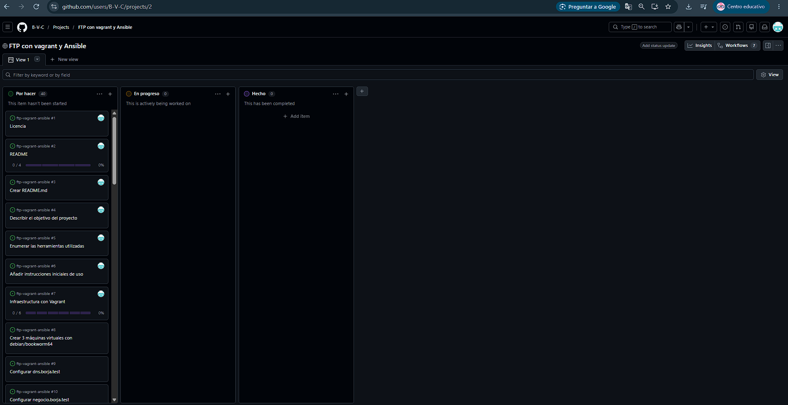

El flujo que he seguido es sencillo: cuando empiezo una tarea, muevo su issue a **En progreso**, y al terminarla pongo `Closes #N` en el mensaje del commit. Cuando el commit llega a `main`, GitHub cierra la issue automáticamente y el tablero la pasa a **Hecho**. Un detalle que descubrí por el camino: si un commit resuelve varias issues, hay que repetir `Closes` delante de cada número (`Closes #3, Closes #4`), porque si se escribe `Closes #3, #4` solo se cierra la primera.

## 3. Licencia

El fichero `LICENSE` lo añadí desde la web de GitHub con **Add file → Create new file**. Al escribir `LICENSE` como nombre aparece el botón **Choose a license template**, que inserta el texto completo de la licencia.

Elegí la **GNU GPL v3.0**, que es la que usa Ansible. Permite usar y modificar el proyecto, pero exige que las versiones modificadas que se distribuyan sigan siendo libres. GitHub la reconoce y la muestra en el apartado **About** del repositorio.

Commit: `Añadida licencia GPLv3 (Closes #1)`. Como lo hice desde la web, después tuve que hacer `git pull` para tener el cambio en local.

## 4. README

El `README.md` de la raíz lo escribí en tres commits, uno por cada parte, para poder cerrar cada sub-issue con su propio commit:

1. Título, autor e introducción (`Closes #3, Closes #4`).
2. Herramientas (`Closes #5`).
3. Cómo ejecutar el proyecto y licencia (`Closes #6, Closes #2`). Con este último cerré también la issue principal.

Más adelante el profesor actualizó el enunciado y la sub-issue del README pasó a pedir también el nombre y la dirección del repositorio. Añadí la línea `Repositorio:` debajo del autor y actualicé la descripción de la issue #3. Como esa issue ya estaba cerrada, en el commit puse `(#3)` en lugar de `Closes #3`; de esta forma el commit queda enlazado en la issue igualmente.

## 5. Vagrant

### 5.1. Fichero `.gitignore`

Antes de crear las máquinas añadí un `.gitignore` con la carpeta `.vagrant/`. Vagrant la genera al hacer `vagrant up` y guarda dentro las claves privadas de las máquinas, que no deberían subirse al repositorio.

```text
# Carpeta de Vagrant con las máquinas y sus claves privadas
.vagrant/
```

Al hacer `git add` apareció este aviso:

```text
warning: in the working copy of '.gitignore', CRLF will be replaced by LF the next time Git touches it
```

En realidad no es un error. VS Code estaba guardando los ficheros con finales de línea de Windows (`CRLF`) y Git los almacena en el repositorio con los de Linux (`LF`). El problema es que Vagrant trabaja con los ficheros de mi carpeta local, no con los del repositorio, y los ficheros con `CRLF` que se copian a las máquinas Debian pueden dar problemas. Para evitarlo cambié en VS Code la opción **Files: Eol** a `\n`, de modo que los ficheros nuevos se crean ya con `LF`.

### 5.2. Script `script/ansible.sh`

Este script prepara la máquina `ansible` como nodo de control, y Vagrant lo ejecuta solo en ella. Básicamente hace tres cosas:

- Instala `ansible`, `ansible-lint` y `whois` (este último incluye `mkpasswd`, que me hará falta para las contraseñas del FTP).
- Copia las claves privadas de `dns` y `negocio` desde `/vagrant/.vagrant/...` a `private_keys/` y les asigna permisos `600`. Si se usaran directamente desde la carpeta compartida con Windows, tendrían permisos demasiado abiertos y SSH se negaría a usarlas.
- Copia los ficheros de Ansible y lanza los playbooks.

Como al principio no existen todos los ficheros, las líneas que los copian están comentadas y las voy descomentando a medida que los creo. Si no lo hiciera así, el script fallaría al intentar copiar algo que todavía no existe, ya que empieza con `set -xeu`: `-e` detiene el script en el primer error, `-u` da error si se usa una variable sin definir y `-x` muestra cada comando antes de ejecutarlo.

Commit: `Añadido script/ansible.sh para preparar el nodo de control (Closes #12)`.

En la versión actualizada del enunciado, el script pone un `chown` justo debajo de cada `cp`, en lugar de dos `chown` al final con todos los ficheros. La ventaja es que cada línea se puede descomentar por separado; con la versión anterior no podía activar `chown -R vagrant:vagrant ./{dns,web,ftp}` hasta tener las tres carpetas. Lo adapté igual que en el enunciado, aunque con una corrección: después de copiar `requirements.yml`, el enunciado vuelve a hacer `chown ./inventory.yml`, y yo puse `chown ./requirements.yml`, que es lo que tiene sentido.

```bash
cp -vf /vagrant/requirements.yml .
chown vagrant:vagrant ./requirements.yml
```

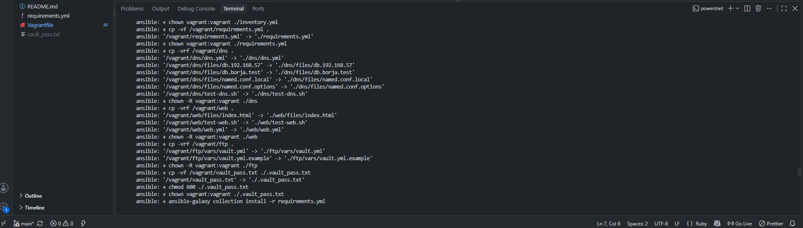

Commit: `ansible.sh: un chown por cada fichero copiado, como en la versión actualizada del enunciado`.

### 5.3. Fichero `requirements.yml`

Aquí se indican las colecciones de Ansible que necesita el proyecto. Solo hay una, `community.crypto`, que incluye los módulos para generar el certificado del FTP:

```yaml
---
collections:
  - name: community.crypto
```

Commit: `Añadido requirements.yml con la colección community.crypto (Closes #13)`.

Después descomenté en `ansible.sh` las dos líneas que lo utilizan: la que lo copia y la que instala las colecciones con `ansible-galaxy collection install -r requirements.yml`.

### 5.4. Fichero `Vagrantfile`

Define las tres máquinas con la imagen `debian/bookworm64` en la red privada `192.168.57.0/24`:

```ruby
Vagrant.configure("2") do |config|
  config.vm.box = "debian/bookworm64"

  config.vm.define "dns" do |dns|
    dns.vm.hostname = "dns.borja.test"
    dns.vm.network "private_network", ip: "192.168.57.5"
  end

  config.vm.define "negocio" do |negocio|
    negocio.vm.hostname = "negocio.borja.test"
    negocio.vm.network "private_network", ip: "192.168.57.7"
  end

  config.vm.define "ansible" do |ansible|
    ansible.vm.hostname = "ansible.borja.test"
    ansible.vm.network "private_network", ip: "192.168.57.6"
    ansible.vm.provision "shell", path: "script/ansible.sh"
  end
end
```

Más adelante le añadí la memoria de las máquinas, primero 1 GB y después 2 GB, por los problemas que explico en los apartados 5.6 y 9.5.

La máquina `ansible` está definida la última a propósito. Vagrant crea las máquinas en orden y su script copia las claves de `dns` y `negocio`, así que si se creara antes esas claves todavía no existirían.

La primera vez que hice `vagrant up` me salió esto:

```text
A Vagrant environment or target machine is required to run this
command. Run `vagrant init` to create a new Vagrant environment.
```

El fallo era que había escrito mal el nombre del fichero. Tiene que llamarse exactamente `Vagrantfile`, con la `V` mayúscula y sin extensión. Después de renombrarlo funcionó sin problemas.

### 5.5. Comprobaciones

Con `vagrant up` se crean las tres máquinas, y en la salida se puede ver cómo el script instala Ansible, copia las claves e instala `community.crypto`.

```bash
vagrant status
```


Las tres máquinas aparecen en estado `running`. (En el enunciado dice que "deben aparecer las dos máquinas", pero en realidad son tres.)

Para comprobar el nombre y la IP de cada una, lanzo un comando en cada máquina sin necesidad de entrar en ella:

```bash
vagrant ssh dns -c "hostname -f; ip -4 -br addr show eth1"
```

```bash
vagrant ssh negocio -c "hostname -f; ip -4 -br addr show eth1"
```

```bash
vagrant ssh ansible -c "hostname -f; ip -4 -br addr show eth1"
```

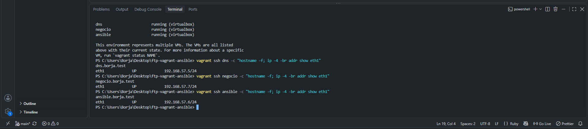

Cada una tiene su nombre completo y su IP en `eth1`, que es la tarjeta de la red privada: `dns.borja.test` con `192.168.57.5`, `negocio.borja.test` con `192.168.57.7` y `ansible.borja.test` con `192.168.57.6`.

Commit: `Añadido Vagrantfile con las máquinas dns, negocio y ansible (Closes #8, Closes #9, Closes #10, Closes #11, Closes #7)`.

### 5.6. Problema: las máquinas se quedaban colgadas

Uno de los días, al hacer `vagrant provision ansible`, el playbook del DNS se quedó parado en `TASK [Instalar BIND]` y no avanzaba. En la máquina `dns` no había ningún proceso de `apt` en marcha y, poco después, tampoco respondía `vagrant ssh ansible -c "hostname"`. Intenté reiniciarlas con `vagrant reload`, pero `dns` no respondía al apagado normal, así que tuve que forzarlo:

```bash
vagrant halt -f
```

El primer intento me dio un error diciendo que otro proceso de Vagrant tenía bloqueada la máquina (`another process is already executing an action on the machine`). Era el `vagrant provision` que había cancelado, que seguía ejecutándose en segundo plano. Lo cerré desde el Administrador de tareas finalizando los procesos `ruby.exe` (que son los de Vagrant), y entonces sí se apagaron.

Después reinicié Windows y, al hacer `vagrant up`, apareció esto:


La máquina se había quedado en estado `saved` (se guardó al reiniciar el ordenador con ella encendida) y VirtualBox no era capaz de reanudarla. El error `VERR_CPUM_INCOMPATIBLE_XSAVE_COMP_MASK` significa que el procesador no tenía la misma configuración que cuando se guardó el estado. `vagrant status` mostraba `aborted-saved` en `dns` y `saved` en las otras dos. Lo solucioné desde VirtualBox, haciendo clic derecho en cada máquina → **Descartar estado guardado**, con lo que quedaron en `poweroff` y ya arrancaron. No se pierde nada importante: lo que se descarta es el contenido de la memoria, no el disco.

Al volver a provisionar, en la tarea `Instalar BIND` salió lo siguiente:


`Killed` indica que Linux había matado el proceso. Revisé la memoria de `dns` con `free -m` y vi que no tenía _swap_; cuando una máquina se queda sin RAM, Linux mata el proceso que más consume. Con BIND funcionando y el `apt update` a la vez, la memoria por defecto no era suficiente, y por eso se colgaba todo.

Para solucionarlo, en el `Vagrantfile` asigné 1 GB a las tres máquinas. Al ponerlo fuera de los bloques `define`, se aplica a todas:

```ruby
  config.vm.provider "virtualbox" do |vb|
    vb.memory = 1024
  end
```

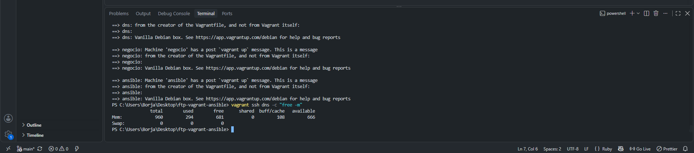

Ahora `total` marca `960` (1 GB menos lo que reserva el sistema). Con este cambio la provisión terminó sin errores:

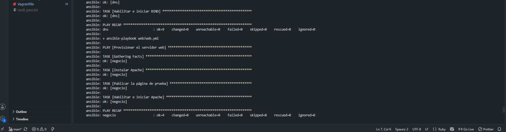

Por último volví a pasar `test-dns.sh` y las 6 pruebas seguían en `[OK]`.

Commit: `Vagrantfile: 1024 MB de RAM para las máquinas, con la memoria por defecto apt se quedaba sin RAM`.

## 6. Ansible

La división de trabajo es la siguiente: Vagrant crea las máquinas y Ansible configura lo que hay dentro. Se podría instalar todo también con un script de Vagrant, pero un script ejecuta los comandos uno tras otro y tiene que controlar por su cuenta qué pasa si se lanza dos veces. Con Ansible, en cambio, las tareas se escriben en playbooks que describen cómo debe quedar la máquina, y si algo ya está como debe, no se vuelve a hacer.

### 6.1. Configuración SSH de las máquinas

Para saber con qué usuario y qué clave entra Vagrant en cada máquina, ejecuto desde mi ordenador:

```bash
vagrant ssh-config
```

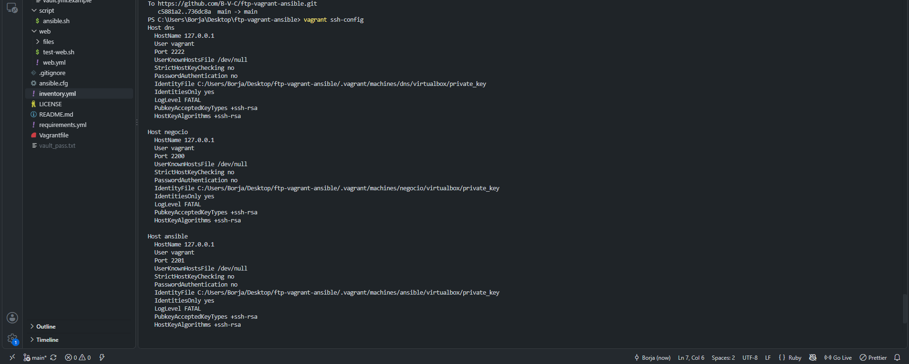

En los tres bloques el usuario es `vagrant` (`User vagrant`) y cada máquina tiene su propia clave privada (`IdentityFile`), ubicada en `.vagrant/machines/<máquina>/virtualbox/private_key`.

También aparece `HostName 127.0.0.1` con un puerto distinto para cada una (2222, 2200 y 2201). Así es como entra Vagrant desde mi ordenador, a través de la tarjeta NAT: usa el 2222 para la primera máquina y, como ya está ocupado, asigna otro a las demás. Ansible no utiliza esto, porque está dentro de la red privada y se conecta directamente a las IPs `192.168.57.5` y `192.168.57.7`.

### 6.2. Fichero `ansible.cfg`

```ini
[defaults]
inventory = inventory.yml
remote_user = vagrant
host_key_checking = False
interpreter_python = auto_silent
```

En el repositorio, el fichero incluye además un comentario encima de cada línea explicándola. Resumiendo lo que hace cada opción:

- `inventory = inventory.yml`: establece el inventario por defecto, para no tener que añadir `-i inventory.yml` en cada comando. El enunciado menciona esta línea en el apartado del inventario, pero no aparece en el ejemplo de `ansible.cfg`, así que la añadí yo.
- `remote_user = vagrant`: el usuario SSH, el mismo que usa Vagrant. Como es igual en todas las máquinas, basta con indicarlo aquí una sola vez.
- `host_key_checking = False`: hace que Ansible no compruebe la identidad del servidor SSH. La primera vez que te conectas a un servidor, SSH pregunta si confías en él, y Ansible se quedaría esperando una respuesta. Conviene aclarar que esto no tiene nada que ver con los certificados TLS. Además, solo es aceptable en un entorno de prácticas: en producción dejaría de protegerte frente a alguien que se haga pasar por el servidor.
- `interpreter_python = auto_silent`: Ansible busca automáticamente el Python de cada máquina sin mostrar avisos.

La clave privada no se indica en este fichero porque cada máquina tiene la suya; esa información va en el inventario. Se trata de la clave que genera Vagrant, que solo sirve para pruebas y no se sube al repositorio (de ahí que `.vagrant/` esté en el `.gitignore`).

Al crear este fichero cometí un error: pegué el contenido dentro de `script/ansible.sh`. Me di cuenta al hacer `git add ansible.cfg`, porque salió `fatal: pathspec 'ansible.cfg' did not match any files`, es decir, el fichero no existía. Con `git status` vi que `script/ansible.sh` aparecía como modificado, así que deshice el cambio y, cuando `git status` volvió a mostrar `working tree clean`, creé el `ansible.cfg` en su sitio.

Commit: `Añadido ansible.cfg con las opciones comunes documentadas (Closes #15)`.

### 6.3. Fichero `inventory.yml`

```yaml
all:
  hosts:
    dns:
      ansible_host: 192.168.57.5
      ansible_ssh_private_key_file: ./private_keys/dns.key.rsa
    negocio:
      ansible_host: 192.168.57.7
      ansible_ssh_private_key_file: ./private_keys/negocio.key.rsa
```

Al igual que `ansible.cfg`, en el repositorio lleva un comentario en cada máquina.

- `dns` y `negocio` son alias, y son los nombres que uso después en los playbooks (`hosts: dns`).
- `ansible_host` es la IP de cada máquina en la red privada.
- `ansible_ssh_private_key_file` indica la clave de cada máquina, en la ruta donde la copia `ansible.sh`.
- La máquina `ansible` no aparece en el inventario porque es desde donde se lanzan los comandos, no una de las máquinas que se configuran.

Commit: `Añadido inventory.yml con las máquinas dns y negocio (Closes #16, Closes #14)`.

### 6.4. Copiar los ficheros a la máquina `ansible`

En `script/ansible.sh` descomenté las líneas que copian `ansible.cfg` e `inventory.yml`, junto con el `chown` que los asigna al usuario `vagrant`. El script se ejecuta como `root`, así que sin ese `chown` los ficheros pertenecerían a `root`.

Como `vagrant up` solo ejecuta el script la primera vez, para volver a lanzarlo hay que usar:

```bash
vagrant provision ansible
```

En la salida se ve la copia de los dos ficheros. También se aprecia que `apt-get` responde `already the newest version` y `ansible-galaxy` dice `Nothing to do`, es decir, no vuelven a instalar lo que ya está instalado.

Después entro en la máquina para revisar los ficheros:

```bash
vagrant ssh ansible
```

```bash
ls -l
```

```bash
ls -l private_keys
```


Los ficheros están en `/home/vagrant`. `ansible.cfg` e `inventory.yml` pertenecen a `vagrant`, y las claves tienen permisos `-rw-------` (600), que es lo que exige SSH. Los ficheros aparecen como ejecutables (`-rwxr-xr-x`) porque la carpeta compartida con Windows (`/vagrant`) no conserva los permisos de Linux y `cp` los copia así, pero no afecta a nada. Las carpetas vacías `dns` y `negocio` las crea el `mkdir` del script, aunque no se llegan a usar.

Commit: `ansible.sh: copiar ansible.cfg e inventory.yml al nodo de control`.

### 6.5. Comprobaciones

Primero compruebo que Ansible lee el inventario:

```bash
ansible-inventory --graph
```

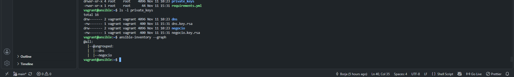

Aparecen `dns` y `negocio` dentro de `@all`, en `@ungrouped` porque no pertenecen a ningún grupo propio. Además, no he puesto `-i inventory.yml` y aun así lo ha encontrado, lo que confirma que también está leyendo `ansible.cfg`.

Para asegurarme del todo, ejecuté también el comando tal y como aparece en el enunciado, con `-i`, y el mismo sin él:

```bash
ansible-inventory -i inventory.yml --graph
```

```bash
ansible-inventory --graph
```


Los dos dan el mismo resultado, porque la línea `inventory = inventory.yml` de `ansible.cfg` actúa como `-i` por defecto.

Después compruebo la conexión con las dos máquinas:

```bash
ansible all -m ping
```

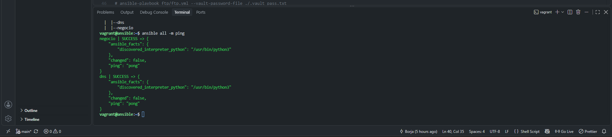

Ambas responden `SUCCESS` con `pong`. Hay que tener en cuenta que este `ping` no es el del sistema (no envía paquetes ICMP): lo que hace es entrar por SSH, comprobar que hay Python y responder. En `discovered_interpreter_python` se ve el Python que ha encontrado, `/usr/bin/python3`. Por cierto, `negocio` aparece antes que `dns` porque Ansible se conecta a las dos a la vez y muestra primero la que responde antes.

Por último, pruebo un comando con privilegios de `root`:

```bash
ansible all -b -a "uptime"
```

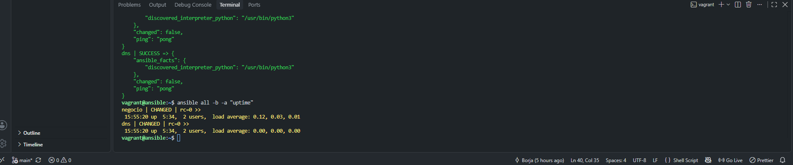

`-a` ejecuta un comando con el módulo `command`, y `-b` (_become_) lo hace con `sudo`. Las dos máquinas devuelven `rc=0`, así que el usuario `vagrant` puede usar `sudo` sin problema. Sale `CHANGED` porque, con `command`, Ansible no tiene forma de saber si el comando ha cambiado algo, así que siempre lo marca como cambiado.

## 7. Servidor DNS

El DNS es el mismo tipo de servidor que monté en la práctica anterior con BIND9. La diferencia es que esta vez no lo configuro a mano: escribo los ficheros en el repositorio y un playbook de Ansible se encarga de copiarlos y dejarlo funcionando.

Todo está en la carpeta `dns/`:

```text
dns/
├── dns.yml
├── test-dns.sh
└── files/
    ├── named.conf.options
    ├── named.conf.local
    ├── db.borja.test
    └── db.192.168.57
```

### 7.1. Ficheros de BIND

Cada uno de estos ficheros lo creé y lo subí en su propio commit.

**`named.conf.options`**:

```text
acl confiables {
    127.0.0.1;
    192.168.57.0/24;
};

options {
    directory "/var/cache/bind";
    allow-transfer { none; };
    listen-on port 53 { 127.0.0.1; 192.168.57.5; };
    listen-on-v6 { none; };
    recursion yes;
    allow-recursion { confiables; };
    dnssec-validation auto;
};
```

Es prácticamente igual que el de la práctica anterior, cambiando la red `56` por la `57`. Tal y como pide el enunciado, la recursión solo se permite al propio servidor y a la red privada. Hay dos cambios respecto a la versión anterior:

- En la práctica anterior limitaba BIND a IPv4 con la opción `-4` en `/etc/default/named`. Esta vez lo hago con `listen-on-v6 { none; }` dentro de las opciones, y así me ahorro copiar otro fichero.
- Uso `dnssec-validation auto`, que es el valor por defecto en Debian: BIND valida DNSSEC con la clave de la raíz que trae incluida.

**`named.conf.local`** declara las dos zonas. Las rutas apuntan a `/var/lib/bind/`, que es donde el playbook copia las zonas:

```text
zone "borja.test" {
    type master;
    file "/var/lib/bind/db.borja.test";
};

zone "57.168.192.in-addr.arpa" {
    type master;
    file "/var/lib/bind/db.192.168.57";
};
```

**`db.borja.test`**, la zona directa:

```text
$TTL 86400
@   IN SOA dns.borja.test. admin.borja.test. (
        2026111301 ; Serial
        3600       ; Refresh
        1800       ; Retry
        604800     ; Expire
        86400 )    ; Negative Cache TTL
;
@        IN NS     dns.borja.test.
dns      IN A      192.168.57.5
negocio  IN A      192.168.57.7
www      IN CNAME  negocio.borja.test.
ftp      IN CNAME  negocio.borja.test.
```

`www` y `ftp` son alias de `negocio`. De esta forma, el navegador va a `www.borja.test` y FileZilla a `ftp.borja.test`, pero los dos acaban en la misma máquina.

**`db.192.168.57`**, la zona inversa, con un PTR para cada máquina. El número corresponde al último octeto de la IP:

```text
@   IN NS   dns.borja.test.
5   IN PTR  dns.borja.test.
7   IN PTR  negocio.borja.test.
```

`www` y `ftp` no tienen PTR porque son alias: la IP `.7` apunta al nombre real de la máquina, `negocio.borja.test`.

Los dos ficheros de zona terminan con un salto de línea. En la práctica anterior `named-checkzone` me avisaba con `file does not end with newline`, así que esta vez lo tuve en cuenta desde el principio.

### 7.2. Playbook `dns/dns.yml`

Es el playbook del enunciado cambiando `equipo` por `borja`. Lo único que he añadido es el paquete `bind9-dnsutils`, que incluye `dig` y `nslookup` para el script de pruebas.

Los pasos que sigue son:

1. Instala `bind9` y `bind9-dnsutils` con el módulo `apt`.
2. Copia `named.conf.options` y `named.conf.local` a `/etc/bind/`.
3. Copia las dos zonas a `/var/lib/bind/` con propietario `bind`, para que BIND pueda leerlas. Lo hace en una sola tarea con un `loop` que recorre los dos ficheros.
4. Comprueba la configuración con `named-checkconf` y cada zona con `named-checkzone`, los mismos comandos que usé a mano en la práctica anterior. Si encuentra algún error, el playbook se detiene antes de reiniciar BIND.
5. Deja BIND habilitado y en ejecución.

Las tareas que copian ficheros llevan `notify: Reiniciar BIND`. Si alguna de ellas cambia algo, avisa al _handler_, que reinicia BIND una única vez al final. Las tareas de comprobación llevan `changed_when: false` porque no modifican nada; sin esa opción, Ansible las marcaría siempre como `changed`, igual que pasó con `uptime`.

Para que el playbook se ejecutara, descomenté en `script/ansible.sh` la línea que copia la carpeta `dns` y la que lanza `ansible-playbook dns/dns.yml`. En cambio, dejé comentada la línea `chown -R vagrant:vagrant ./{dns,web,ftp}`, porque `web` y `ftp` todavía no existían y, con `set -e`, el script se habría detenido.

### 7.3. Problema: la fecha de las máquinas

Al día siguiente, `vagrant status` indicaba que las máquinas estaban en `saved`. Las arranqué con `vagrant up` y lancé `vagrant provision ansible`, pero falló el `apt-get update`:


`apt` decía que los ficheros de Debian "todavía no eran válidos" (`is not valid yet`), así que miré la fecha de la máquina:

```bash
vagrant ssh ansible -c "date"
```


Tenía la fecha del día en que dejé de trabajar, dos días antes. El estado `saved` funciona como suspender el ordenador: VirtualBox guarda la máquina tal cual y el reloj se queda congelado. Al reanudarla seguía con esa hora, de modo que, para ella, los ficheros de Debian venían "del futuro". Y como el script tiene `set -e`, en cuanto falló `apt-get update` se paró.

La solución fue reiniciar las tres máquinas, que al arrancar sincronizan la hora con el ordenador:

```bash
vagrant reload
```

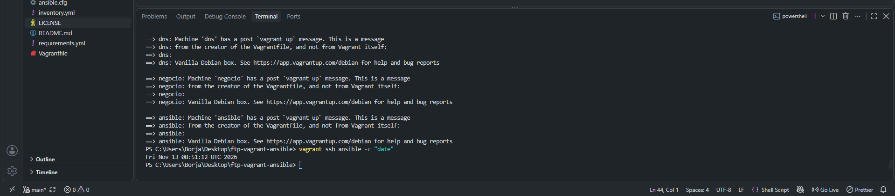

Desde entonces, antes de apagar el ordenador apago las máquinas con `vagrant halt` para que no se queden en `saved`.

### 7.4. Ejecución del playbook

```bash
vagrant provision ansible
```


El resumen muestra `ok=10 changed=5 failed=0`. Las 5 tareas `changed` corresponden a la instalación, las tres copias de ficheros y el reinicio. Las comprobaciones salen como `ok` gracias al `changed_when: false`. Además, el _handler_ `Reiniciar BIND` se ejecuta una sola vez al final, aunque lo hayan notificado tres tareas.

Para comprobar que Ansible analiza el playbook sin errores, ejecuto dentro de la máquina `ansible`:

```bash
ansible-playbook dns/dns.yml --syntax-check
```

```bash
ansible-lint dns/dns.yml
```


`--syntax-check` se limita a comprobar que el YAML y la estructura son correctos, sin ejecutar nada. `ansible-lint`, por su parte, revisa además buenas prácticas. El playbook pasa con el perfil `production`, que es el más estricto, con 0 fallos y 0 avisos.

El playbook también se puede lanzar a mano desde el nodo de control, tal y como aparece en el enunciado. Dentro de la máquina `ansible`:

```bash
ansible-playbook -i inventory.yml dns/dns.yml
```


Esta vez sale `changed=0`, porque el DNS ya estaba configurado. Es exactamente lo mismo que hace el script con `vagrant provision`, solo que lanzado por mí desde `ansible`.

Commits: uno para el playbook y otro para el cambio en `ansible.sh`.

### 7.5. Script de pruebas `dns/test-dns.sh`

El script hace consultas a `192.168.57.5` con `dig ... +short` y compara cada respuesta con la esperada:

- Registros A: `dns` y `negocio`.
- CNAME: `www` y `ftp`, que deben apuntar a `negocio.borja.test.`.
- PTR: `192.168.57.5` y `192.168.57.7`.

Si la respuesta coincide muestra `[OK]` y, si no, `[FALLO]`. Al final termina con código `0` si todo ha ido bien o con el número de fallos en caso contrario. Es una mejora respecto a la práctica anterior, donde el `test.sh` solo mostraba las respuestas y tenía que revisarlas yo a mano; este las comprueba automáticamente.

Lo ejecuto en la máquina `dns`, que es la que tiene `dig`:

```bash
vagrant ssh dns -c "bash /vagrant/dns/test-dns.sh"
```

La primera vez obtuve esto:


Con `ls dns` descubrí que había llamado al fichero `test.dns.sh`, con un punto en lugar de guion. Tras renombrarlo a `test-dns.sh`:


Las 6 pruebas salen `[OK]`.

Commit: `DNS: añadido script de pruebas de los registros directos e inversos (Closes #18, Closes #19, Closes #20, Closes #21, Closes #22, Closes #23, Closes #24, Closes #17)`. Como el script comprueba todas las sub-issues del DNS, las cerré todas con este mismo commit.

### 7.6. DNS en mi ordenador

Para poder usar `www.borja.test` en el navegador y `ftp.borja.test` en FileZilla, configuré mi servidor como DNS en Windows. En **Conexiones de red** (`ncpa.cpl`) → adaptador Ethernet → **Propiedades** → **TCP/IPv4**:

- DNS preferido: `192.168.57.5`
- DNS alternativo: `8.8.8.8`

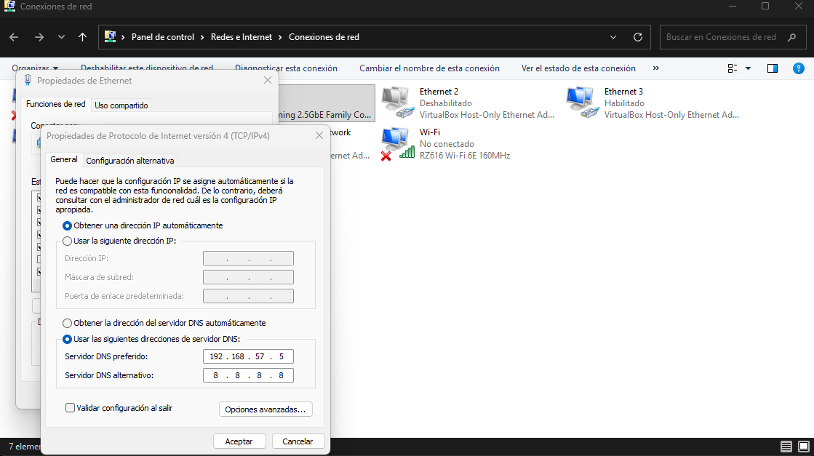

El DNS alternativo lo añadí por mi cuenta para no quedarme sin Internet cuando las máquinas están apagadas: si el primero no responde, Windows recurre al segundo. Antes lo tenía en automático, y cuando acabe la práctica lo volveré a dejar así.

Para comprobarlo, hago las consultas desde Windows sin indicar el servidor, y así veo que lo usa por sí solo:

```bash
nslookup www.borja.test
```

```bash
nslookup ftp.borja.test
```

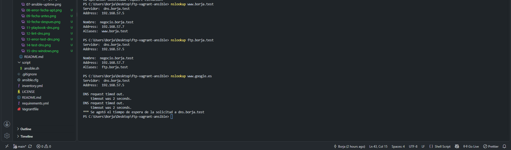

Responde `dns.borja.test` (`192.168.57.5`); aparece el nombre del servidor porque `nslookup` lo obtiene de mi zona inversa. `www` y `ftp` figuran como alias de `negocio.borja.test` con la IP `192.168.57.7`.

También probé con un nombre de Internet:

```bash
nslookup www.google.es
```

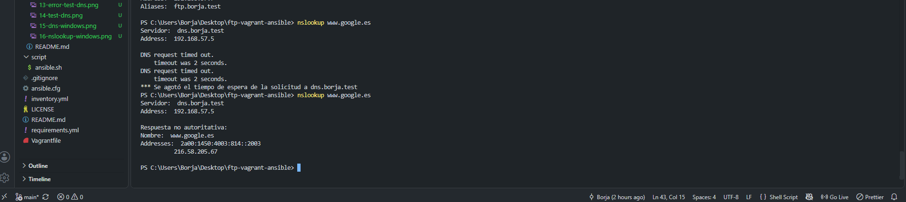

Las dos primeras veces dio `DNS request timed out`. Para resolver un nombre externo, mi servidor tiene que ir preguntando desde los servidores raíz y además validar DNSSEC, y la primera vez tardaba más de los 2 segundos que espera `nslookup`. A la tercera ya lo tenía en caché y respondió. Aparece `Respuesta no autoritativa` porque mi servidor no es el responsable de `google.es`, sino que ha obtenido la respuesta por recursión. Es lo mismo que indicaba la flag `aa` en la práctica anterior.

Más tarde, al probar la web en el navegador, me di cuenta de que esta configuración no era suficiente: `nslookup` funcionaba, pero el navegador no. Lo explico en el apartado 8.6.

## 8. Servidor web

El servidor web está en `negocio`, igual que el FTP. Todo se encuentra en la carpeta `web/`:

```text
web/
├── web.yml
├── test-web.sh
└── files/
    └── index.html
```

### 8.1. Página y playbook

`files/index.html` es una página muy sencilla con un texto que después busca el script de pruebas:

```html
<h1>Servidor web de borja.test</h1>
```

El playbook `web.yml` es el del enunciado: instala `apache2`, copia la página a `/var/www/html/` y deja Apache habilitado y en marcha. Si la página cambia, un _handler_ reinicia Apache al final, igual que pasaba con BIND.

Al crear `web.yml` hice clic derecho sobre la carpeta y el fichero acabó dentro de `files`. Esto ocurre porque VS Code muestra `web\files` en una sola línea cuando `files` es lo único que contiene, y al hacer clic ahí el fichero se crea en `files`. Lo moví a su sitio con:

```bash
Move-Item web/files/web.yml web/
```

Commits: uno para `index.html` y otro para `web.yml`.

### 8.2. Cambios en `ansible.sh`

Descomenté la línea que copia la carpeta `web` y la que lanza `ansible-playbook web/web.yml`.

Para la prueba con `curl` necesitaba tener ese programa en la máquina `ansible`, pero `which curl` no devolvía nada, porque la imagen de Debian no lo incluye. Lo añadí a la línea de instalación del script:

```bash
apt-get install -y ansible ansible-lint whois curl
```

Commit: `ansible.sh: instalar curl, copiar la carpeta web y ejecutar el playbook web`.

### 8.3. Ejecución

```bash
vagrant provision ansible
```

Ahora se ejecutan los dos playbooks. El del DNS queda así:

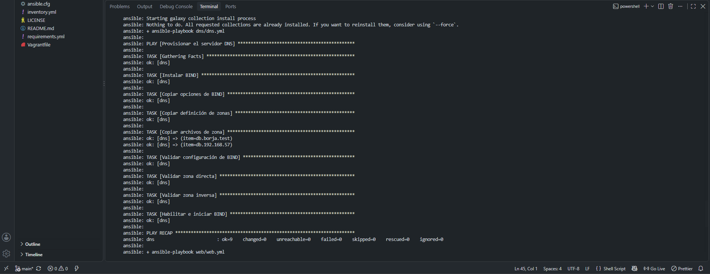

Todas las tareas salen en `ok` y el resumen es `changed=0`. Como no había cambiado nada en el DNS, Ansible no ha tocado nada y el _handler_ no se ha ejecutado, así que BIND no se ha reiniciado. Esta es precisamente la ventaja frente a un script: se puede ejecutar tantas veces como haga falta y solo se cambia lo necesario.

El de la web:

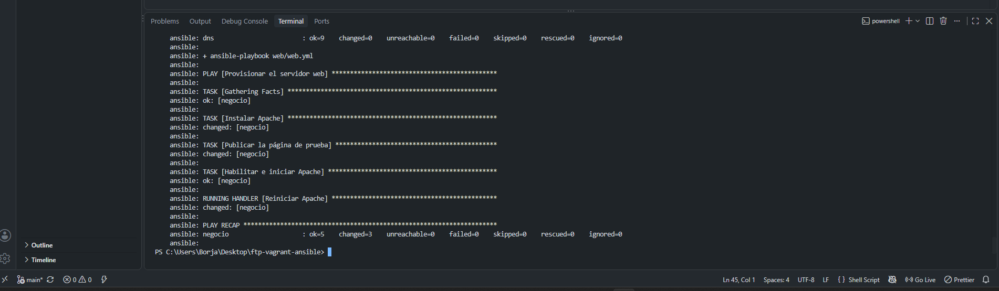

`ok=5 changed=3 failed=0`: instala Apache, copia la página y lo reinicia con el _handler_.

Igual que con el DNS, también lo lancé a mano desde la máquina `ansible`:

```bash
ansible-playbook -i inventory.yml web/web.yml
```

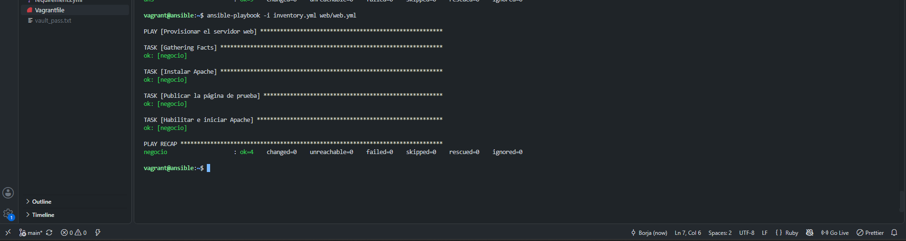

Como ya estaba todo configurado, sale `changed=0`.

### 8.4. Comprobaciones del servidor

Dentro de la máquina `ansible`:

```bash
ansible-playbook web/web.yml --syntax-check
```

```bash
ansible-lint web/web.yml
```

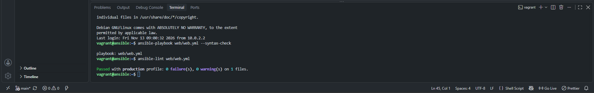

Al igual que el del DNS, pasa con el perfil `production` sin fallos ni avisos.

Para comprobar que Apache está en funcionamiento se lo pregunto con Ansible, solo a `negocio`:

```bash
ansible negocio -b -a "systemctl is-active apache2"
```

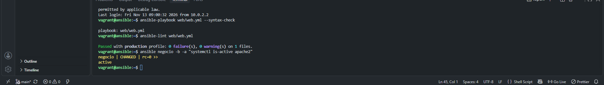

La respuesta es `active`.

### 8.5. Script de pruebas `web/test-web.sh`

Este script descarga la página con `curl` y comprueba dos cosas:

- Que el código HTTP es `200`. Lo obtiene con `curl -s -w "\n%{http_code}"`, que añade el código en una última línea.
- Que la página contiene el texto `Servidor web de borja.test`, usando `grep -q`. Así me aseguro de que Apache sirve mi página y no la de bienvenida que trae por defecto.

Sigue la misma estructura que `test-dns.sh`: `[OK]` o `[FALLO]` en cada prueba y, al final, el número de fallos como código de salida.

En el script uso la IP `192.168.57.7` en lugar de `www.borja.test` porque las máquinas virtuales no utilizan mi servidor DNS, sino el de la red NAT de VirtualBox. El nombre lo compruebo desde el navegador de mi ordenador.

```bash
vagrant ssh ansible -c "bash /vagrant/web/test-web.sh"
```


Commit: `Web: añadido script de prueba con curl (Closes #26, Closes #27, Closes #28, Closes #25)`.

### 8.6. Problema: el navegador no encontraba `www.borja.test`

Al abrir `http://www.borja.test` en el navegador me encontré con esto:


`DNS_PROBE_FINISHED_NXDOMAIN` significa que el nombre no existe. Lo raro es que con `nslookup` sí funcionaba (apartado 7.6). Para ver lo mismo que ve el navegador utilicé `Resolve-DnsName`, que usa el resolvedor de Windows:

```bash
Resolve-DnsName www.borja.test
```

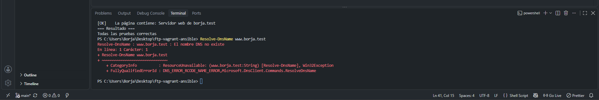

Windows tampoco lo encontraba. La diferencia está en que `nslookup` pregunta directamente al primer servidor DNS de la lista, mientras que el resolvedor de Windows no funciona así. Con `Get-DnsClientServerAddress` revisé los DNS de cada tarjeta y fui probando varias cosas:

1. Además del cable (tarjeta `Ethernet`), tenía la Wi-Fi conectada, con el DNS del router (`192.168.1.1`). La desconecté, pero el problema seguía.
2. Quité el `8.8.8.8` del DNS alternativo, y el error cambió: ya no era "no existe", sino "se agotó el tiempo de espera". Es decir, el "no existe" lo estaba respondiendo `8.8.8.8`, y mi servidor ni siquiera llegaba a contestar.
3. Con `Resolve-DnsName www.borja.test -Server 192.168.57.5` sí funcionaba.

Al final el problema estaba en la tarjeta desde la que salía la consulta. Había configurado el DNS en la tarjeta `Ethernet`, la de mi red de casa, así que Windows enviaba la pregunta con la IP de esa tarjeta. Sin embargo, la red de las máquinas es otra, la de VirtualBox, y la respuesta no volvía por el mismo camino. Con `-Server` o con `nslookup`, en cambio, Windows busca la ruta hasta `192.168.57.5` y sale por la tarjeta de VirtualBox, y por eso sí funcionaba.

Busqué qué tarjeta tiene la IP de mi ordenador en esa red:

```bash
Get-NetIPAddress -AddressFamily IPv4 | Where-Object IPAddress -like "192.168.57.*"
```

Resultó ser `Ethernet 4`, con `192.168.57.1` (las otras dos tarjetas de VirtualBox que tengo pertenecen a otras redes). La configuración final quedó así:

- `Ethernet` (el cable) con el DNS en automático, como estaba al principio. Así, si apago las máquinas, sigo teniendo Internet.
- `Ethernet 4` con DNS `192.168.57.5` y la **métrica** de la interfaz en `1` (en **Opciones avanzadas**, desmarcando **Métrica automática**). La métrica indica la prioridad de la tarjeta: con `1`, Windows pregunta primero a mi servidor.
- La Wi-Fi también en automático.

La primera vez puse en `Ethernet 4` el DNS `192.168.57.1`, que es la IP de mi ordenador y no la del servidor. Me di cuenta al revisar `Get-DnsClientServerAddress` y lo corregí:

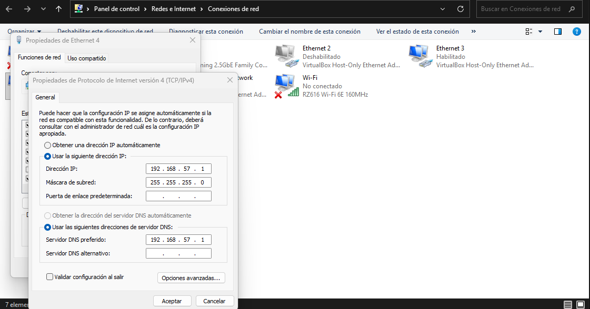

Después vacié la caché con `ipconfig /flushdns` (desde una terminal de administrador, porque si no aparece "La operación solicitada requiere elevación") y volví a probar:

```bash
Resolve-DnsName www.borja.test
```

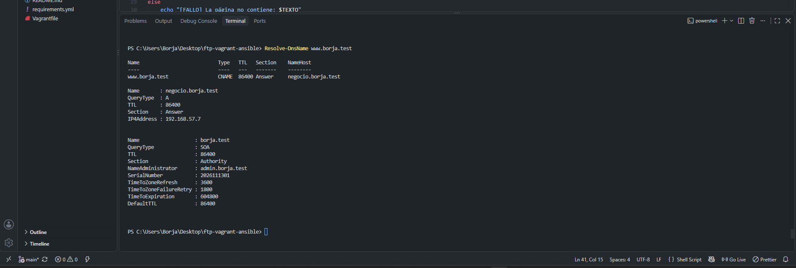

Ahora Windows lo resuelve correctamente: `www.borja.test` es un CNAME de `negocio.borja.test`, con la IP `192.168.57.7`.

Y por fin el navegador carga la página:

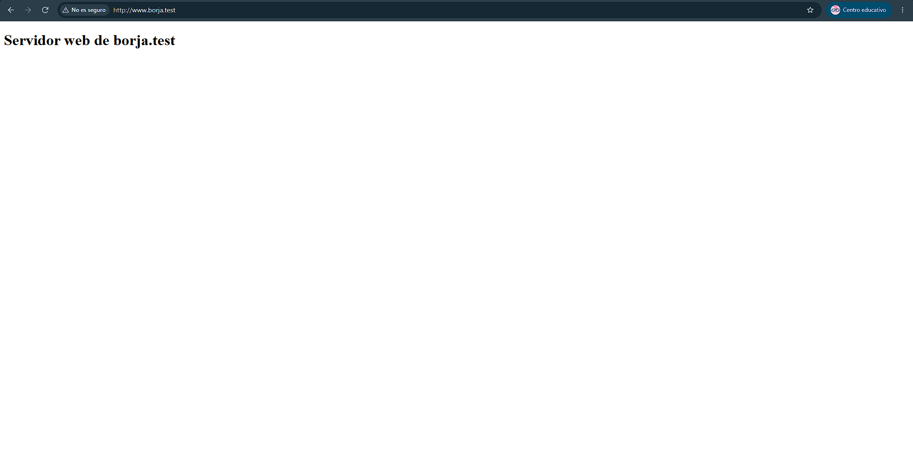

Chrome oculta por defecto el `http://` y el `www.` de la barra de direcciones; para que se vea la dirección completa activé **Mostrar siempre URLs completas** haciendo clic derecho en la barra.

## 9. Servidor FTP

El FTP también está en `negocio`, junto a Apache. Lo he montado con `vsftpd`, con dos usuarios locales (`juan` y `ana`) y conexiones cifradas con TLS.

### 9.1. Contraseñas con Ansible Vault

El módulo `ansible.builtin.user` no acepta la contraseña en claro, sino su **hash**. Los generé en la máquina `ansible` con `mkpasswd`, que viene en el paquete `whois` que instala el script:

```bash
mkpasswd --method=sha-512
```

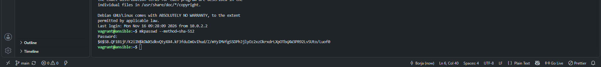

La contraseña se introduce cuando el programa la pide, no como argumento, para que no quede guardada en el historial de la terminal. El hash empieza por `$6$`, lo que indica que es SHA-512. Lo que va entre el segundo y el tercer `$` es la _salt_, un valor aleatorio; por eso cada vez se obtiene un hash distinto aunque la contraseña sea la misma. Generé uno para `juan` (contraseña `juan`) y otro para `ana` (contraseña `ana`).

Los hashes se guardan en `ftp/vars/vault.yml`, cifrado con Ansible Vault usando la contraseña `daw`:

```bash
EDITOR=nano ansible-vault create /vagrant/ftp/vars/vault.yml
```

Lo creo en `/vagrant`, que es la carpeta del proyecto, para que aparezca en el repositorio. Indico `nano` porque el editor que abre por defecto es `vi`. La primera vez cerré la terminal sin querer antes de guardar y, al repetir el comando, me decía `vault.yml exists, please use 'edit' instead`, porque el fichero se había llegado a crear a medias. Lo borré con `rm` y lo volví a crear.

```bash
head -n 3 /vagrant/ftp/vars/vault.yml
```

```bash
ansible-vault view /vagrant/ftp/vars/vault.yml
```


Con `head` se ve el fichero tal y como está guardado: la cabecera `$ANSIBLE_VAULT;1.1;AES256` y el contenido cifrado. Con `ansible-vault view` y la contraseña se pueden ver los hashes. `view` muestra el contenido con `less`, así que para salir hay que pulsar `q`.

El fichero `vault.yml` sí se sube al repositorio, ya que está cifrado. Además subí `ftp/vars/vault.yml.example`, sin cifrar y con marcadores en lugar de hashes, para que se pueda ver la estructura.

La contraseña `daw` está en `vault_pass.txt`, en la raíz del proyecto, para que el script la copie a la máquina `ansible` y el playbook pueda leer el vault sin pedirla. Este fichero está en el `.gitignore` y no se sube. De hecho, lo añadí al `.gitignore` antes de crearlo, para evitar subirlo por error.

En `script/ansible.sh` descomenté la copia de la carpeta `ftp`, el `chown -R` de las tres carpetas (que hasta ahora no podía activar porque faltaban `web` y `ftp`) y la copia de la contraseña a `.vault_pass.txt` con permisos `600`. A esta última le añadí un `chown vagrant:vagrant`, porque si no el fichero pertenecería a `root` y, entrando como `vagrant`, no podría usarlo para lanzar el playbook a mano.

```bash
vagrant ssh ansible -c "ls -l .vault_pass.txt; ansible-vault view ftp/vars/vault.yml --vault-password-file .vault_pass.txt"
```

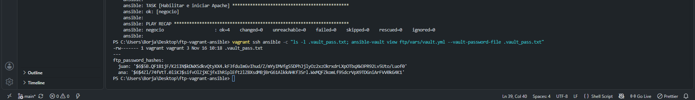

El fichero pertenece a `vagrant`, tiene permisos `-rw-------` y ocupa 3 bytes (`daw`). Con `--vault-password-file` el vault se descifra sin tener que escribir la contraseña.

### 9.2. Playbook `ftp/ftp.yml`

Es el playbook del enunciado actualizado. El único hueco que había que rellenar era el dominio: `domain_name: "borja.test"`. Lo que hace es lo siguiente:

- Instala `vsftpd` y `python3-cryptography`, que es lo que necesita `community.crypto` en `negocio` para generar el certificado.
- Crea los grupos `ftpusers` y `webpublish`, y los usuarios `juan` y `ana` con el hash de su contraseña sacado del vault (`ftp_password_hashes[item]`). Los dos pertenecen a `ftpusers`, y solo `ana` a `webpublish`.
- Deja `/var/www/html` con propietario `root`, grupo `webpublish` y permisos `2775`. El `2` corresponde al bit _setgid_, que hace que todo lo que se cree dentro herede el grupo `webpublish`.
- Asigna permisos `0664` y grupo `webpublish` al `index.html`, para que `ana` pueda sobrescribirlo.
- Genera el certificado en tres pasos: la clave privada, el CSR (con `ftp.borja.test` y `www.borja.test` como nombres alternativos) y el certificado autofirmado con validez de un año. Se guardan en `/etc/ssl/ftp/`. En el texto del enunciado aparece `/etc/ssl/equipo/vsftpd.crt`, pero las rutas válidas son las del playbook, que es quien los crea.
- Copia `vsftpd.chroot_list` y `vsftpd.conf`, y reinicia vsftpd con un _handler_ si cambian.

Commit: `FTP: añadido el playbook ftp.yml con los usuarios, los grupos y el certificado`.

### 9.3. `vsftpd.chroot_list` y `vsftpd.conf`

`ftp/files/vsftpd.chroot_list` contiene una sola línea: `ana`. Es la lista de usuarios que **no** se enjaulan.

En `vsftpd.conf` rellené los huecos del enunciado de esta forma:

| Hueco                      | Lo que puse                                                                                      |
| -------------------------- | ------------------------------------------------------------------------------------------------ |
| Modo independiente IPv4    | `listen=YES` y `listen_ipv6=NO`                                                                  |
| Acceso con cuentas locales | `anonymous_enable=NO`, `local_enable=YES` y `write_enable=YES`                                   |
| Enjaular excepto a ana     | `chroot_local_user=YES`, `chroot_list_enable=YES` y `chroot_list_file=/etc/vsftpd.chroot_list`   |
| Certificados               | `rsa_cert_file=/etc/ssl/ftp/borja.test.crt` y `rsa_private_key_file=/etc/ssl/ftp/borja.test.key` |

Con `chroot_local_user=YES` se enjaula a todos los usuarios locales en su carpeta personal, y con `chroot_list_enable=YES` los que aparecen en la lista quedan como excepción. Así, `juan` queda enjaulado y `ana` no.

El enunciado pide investigar qué significa `allow_writeable_chroot=YES`. Por seguridad, vsftpd no permite enjaular a un usuario en una carpeta en la que pueda escribir, y en ese caso da el error `refusing to run with writable root inside chroot()`. Con esta opción en `YES` se permite. En nuestro caso es necesaria porque la carpeta de `juan` le pertenece y puede escribir en ella.

Además, añadí algunas opciones que no formaban parte de los huecos:

- `pam_service_name=vsftpd` y `secure_chroot_dir=/var/run/vsftpd/empty`. Este fichero sustituye por completo al de Debian, y estas dos opciones venían en el original; sin ellas, vsftpd usa otros valores que en Debian no funcionan.
- `ssl_sslv2=NO` y `ssl_sslv3=NO`, porque el comentario del enunciado dice "sin SSL obsoleto".

Al crear `vsftpd.conf` escribí la ruta `ftp/files/vsftpd.conf` con la carpeta `files` seleccionada, y VS Code lo creó en `ftp/files/ftp/files/vsftpd.conf`. Lo moví con `Move-Item` y borré las carpetas sobrantes con `Remove-Item ftp/files/ftp -Recurse`. Al moverlo perdí lo que había pegado sin guardar, así que tuve que volver a pegarlo.

Commits: uno para `vsftpd.chroot_list` y otro para `vsftpd.conf`.

### 9.4. La carpeta de `ana` en `/var/www/html`

El enunciado pide que la raíz FTP de `ana` sea `/var/www/html`. Como no está enjaulada, `ana` podía llegar a esa carpeta, pero al conectarse empezaba en `/home/ana`. Por suerte, vsftpd permite configurar cada usuario por separado: en `vsftpd.conf` añadí `user_config_dir=/etc/vsftpd_user_conf`, y en esa carpeta se coloca un fichero con el nombre de cada usuario. El de `ana` (`ftp/files/vsftpd_user_conf/ana`) contiene:

```text
local_root=/var/www/html
```

En el playbook añadí una tarea que copia esa carpeta:

```yaml
- name: Copiar la configuración propia de cada usuario (raíz FTP de ana)
  ansible.builtin.copy:
    src: files/vsftpd_user_conf/
    dest: /etc/vsftpd_user_conf/
    owner: root
    group: root
    mode: "0644"
    directory_mode: "0755"
  notify: Reiniciar vsftpd
```

La barra al final de `src` hace que se copie el contenido de la carpeta y no la carpeta en sí.

Commit: `FTP: la raíz FTP de ana es /var/www/html con una configuración propia por usuario`.

### 9.5. Ejecución y problemas de memoria

Descomenté en `ansible.sh` la última línea, la del playbook del FTP con `--vault-password-file ./.vault_pass.txt`, y lancé `vagrant provision ansible`. Esta vez falló en el `apt-get install` del script:


`dpkg` se había quedado a medias el día que apagué las máquinas a la fuerza. Lo arreglé ejecutando `sudo dpkg --configure -a` en las tres máquinas, pero en `ansible` quedaba pendiente terminar una actualización del núcleo de Linux y, al generar su fichero de arranque, el proceso volvió a salir con `Killed`:

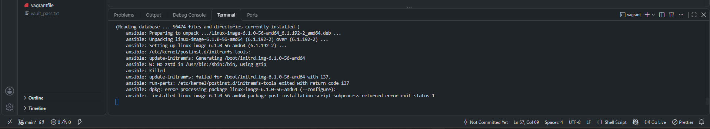

De nuevo era falta de memoria: con 1 GB no tenía suficiente. Le asigné 2 GB a `ansible` y `dpkg --configure -a` terminó correctamente:


Más adelante le pasó lo mismo a `negocio`: se colgó al hacer `vagrant ssh` y también tenía el núcleo a medio actualizar. Como mi ordenador tiene 32 GB, decidí poner 2 GB para las tres máquinas en el bloque general del `Vagrantfile` y eliminé el bloque que había añadido solo para `ansible`.

Con esto, el playbook del FTP funcionó:

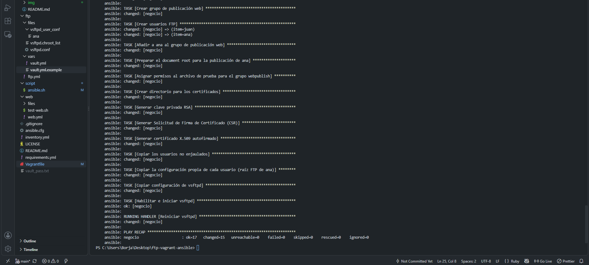

`ok=17 changed=15 failed=0`. Aparece el aviso `Collection community.crypto does not support Ansible version 2.14.18`, porque `ansible-galaxy` instala la última versión de la colección, pensada para versiones de Ansible más recientes que la que trae Debian. Aun así funciona sin problema y el certificado se genera.

### 9.6. `ansible-lint` del playbook FTP

Al pasar `ansible-lint ftp/ftp.yml` apareció `Attempting to decrypt but no vault secrets found`. Esto pasa porque `ansible-lint` hace internamente un `--syntax-check` y no tenía la contraseña del vault. No tiene ninguna opción para indicársela, pero se puede hacer mediante una variable de entorno:

```bash
ANSIBLE_VAULT_PASSWORD_FILE=.vault_pass.txt ansible-lint ftp/ftp.yml
```

De esta forma ya pudo analizar el playbook, y encontró un fallo:

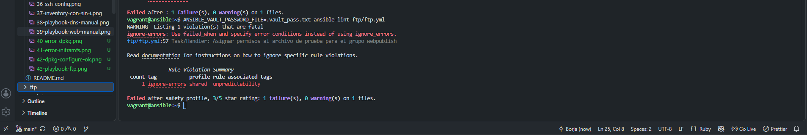

La tarea que asigna permisos al `index.html` tenía `ignore_errors: true`, por si el fichero todavía no existía. `ansible-lint` lo considera una mala práctica, ya que ignora cualquier error, incluidos los que no esperas, y por ello el playbook se quedaba en el perfil `safety`, con 3 de 5 estrellas. Lo sustituí por una comprobación previa:

```yaml
- name: Comprobar si existe la página de prueba
  ansible.builtin.stat:
    path: /var/www/html/index.html
  register: pagina_prueba

- name: Asignar permisos al archivo de prueba para el grupo webpublish
  ansible.builtin.file:
    path: /var/www/html/index.html
    owner: root
    group: webpublish
    mode: "0664"
    state: file
  when: pagina_prueba.stat.exists
```

`stat` consulta el fichero sin modificar nada, y la tarea siguiente solo se ejecuta si existe.


Ahora pasa con el perfil `production`, igual que los del DNS y la web.

Commit: `FTP: comprobar si existe index.html en vez de ignore_errors, para pasar ansible-lint (Closes #30)`.

### 9.7. Los playbooks de la web y del FTP se contradicen

Al volver a provisionar, sin haber cambiado nada, aparecía esto:

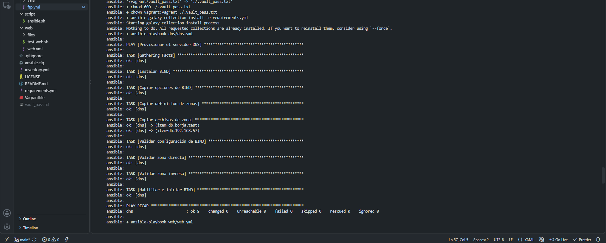

La tarea `Publicar la página de prueba` (de la web) deja el `index.html` como `root:root 0644`, mientras que `Asignar permisos al archivo de prueba` (del FTP) lo deja como `root:webpublish 0664`. En cada provisión uno lo cambia y el otro lo vuelve a cambiar, por lo que siempre aparecen como `changed` y Apache se reinicia sin necesidad. Además, si `ana` sube una página y luego se vuelve a provisionar, el playbook de la web la sobrescribe con la del repositorio. Por este motivo hice las pruebas con FileZilla sin volver a provisionar.

También aparece siempre como `changed` la tarea `Generar Solicitud de Firma de Certificado (CSR)`, porque `openssl_csr_pipe` genera el CSR en memoria cada vez. El certificado, en cambio, sale como `ok` y no se vuelve a crear.

### 9.8. Comprobaciones en `negocio`

```bash
vagrant ssh negocio -c "systemctl status vsftpd --no-pager"
```

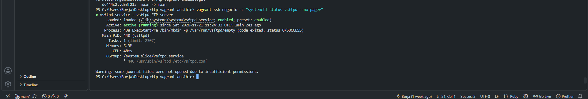

El servicio está `enabled` y `active (running)`, y el proceso es `/usr/sbin/vsftpd /etc/vsftpd.conf`, es decir, funciona por sí mismo en modo independiente.

```bash
vagrant ssh negocio -c "sudo ss -tlnp | grep ':21 '; dpkg -l | grep -i inetd || echo 'inetd no está instalado'"
```


Escucha en `0.0.0.0:21`, que corresponde solo a IPv4 (no hay ninguna línea con `[::]:21`), y `inetd` no está instalado.

```bash
vagrant ssh negocio -c "id juan; id ana; ls -ld /var/www/html; ls -l /var/www/html/index.html"
```


`juan` pertenece a `ftpusers`, y `ana` a `ftpusers` y `webpublish`. `/var/www/html` tiene permisos `drwxrwsr-x` con grupo `webpublish` (la `s` corresponde al _setgid_) y el `index.html` tiene `-rw-rw-r--`.

```bash
vagrant ssh negocio -c "sudo openssl x509 -in /etc/ssl/ftp/borja.test.crt -noout -subject -issuer -dates -ext subjectAltName"
```

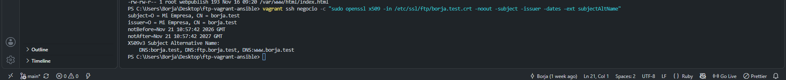

`subject` e `issuer` coinciden, lo que confirma que es autofirmado. Tiene una validez de un año y sus nombres son `borja.test`, `ftp.borja.test` y `www.borja.test`.

## 10. Pruebas con FileZilla

Al descargar FileZilla, Windows bloqueó el instalador porque era la versión _sponsored_, que incluye software publicitario. Descargué la versión sin publicidad desde la lista completa de descargas (`download.php?show_all=1`).

### 10.1. Conexión de `ana`

En el **Gestor de sitios** creé un sitio con el servidor `ftp.borja.test` (por nombre y no por IP), cifrado **Requiere FTP explícito sobre TLS**, usuario `ana` y contraseña `ana`:


Al conectar aparece el aviso del certificado. Sale porque es autofirmado y FileZilla no puede verificar quién lo ha firmado. En él se ven el nombre `borja.test`, los nombres alternativos y las fechas de validez:


Una vez aceptado:

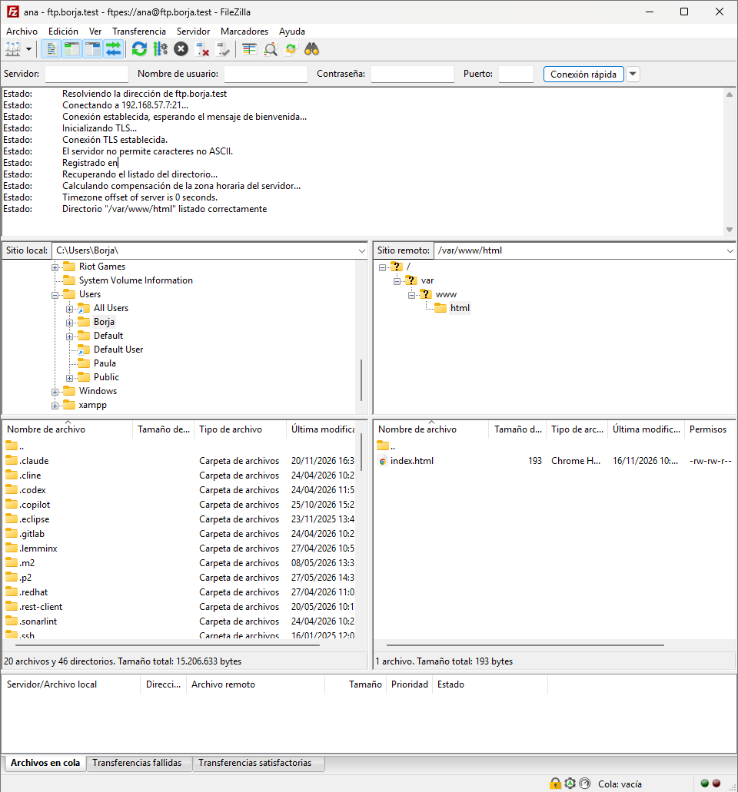

FileZilla resuelve `ftp.borja.test` a `192.168.57.7` usando mi DNS, establece la conexión TLS y `ana` empieza directamente en `/var/www/html`, gracias a su `local_root`. El mensaje `El servidor no permite caracteres no ASCII` indica que vsftpd no admite tildes ni eñes en los nombres de los ficheros.

### 10.2. Subida de una página

Creé un `index.html` nuevo en una carpeta fuera del repositorio. La primera vez se quedó como `index.html.txt` y vacío, porque el Explorador de Windows ocultaba la extensión. Una vez corregido, lo subí arrastrándolo a `/var/www/html` y sobrescribiendo el que había:


`Transferencia correcta, transferidos 283 bytes`. Justo después aparece `Se ha recibido una alerta TLS del servidor: Decode error (50)`, que se produce al cerrar la conexión de la transferencia, cuando el fichero ya ha llegado entero. Es un problema conocido entre vsftpd con TLS y FileZilla al cerrar la sesión, y no afecta a la subida.

En el navegador, tras recargar con **Ctrl + F5** para evitar la caché:


Apache sirve la página que ha subido `ana`.

### 10.3. `juan` enjaulado

Dupliqué el sitio cambiando el usuario por `juan`:

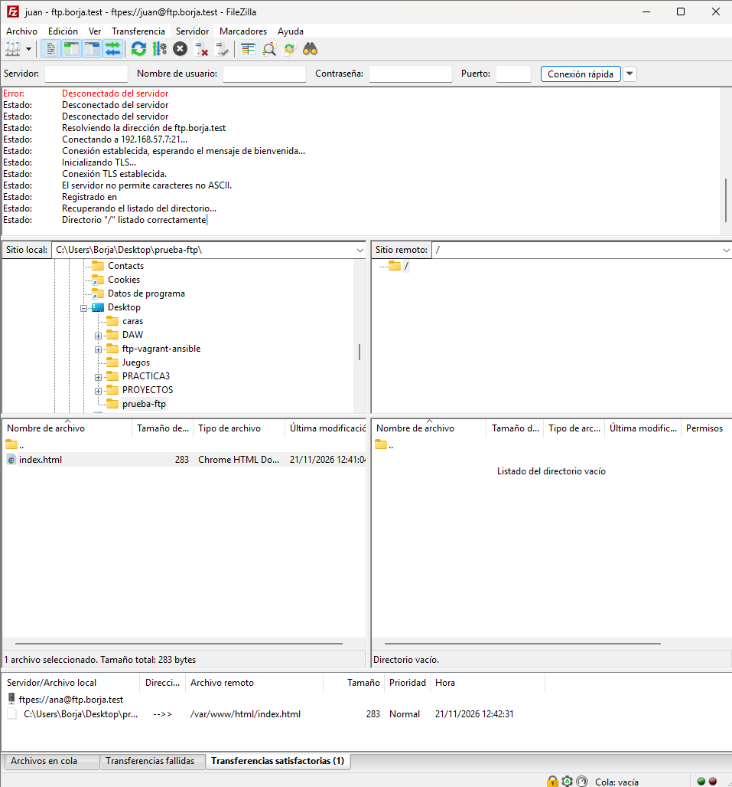

`juan` ve su carpeta como `/`. En realidad es `/home/juan`, pero al estar enjaulado, vsftpd le hace creer que es la raíz. Si intenta ir a `/var/www/html`:


Obtiene `550 Failed to change directory`, porque dentro de su jaula esa carpeta no existe.

### 10.4. Accesos rechazados

Con el modo de acceso **Anónimo**:


Lo rechaza con un `530`, debido a `anonymous_enable=NO`.

Con un usuario que no existe (`pepe`):


`530 Login incorrect`. Solo pueden entrar los usuarios locales con su contraseña.

## 11. Prueba desde cero

El enunciado pide comprobar que, borrándolo todo y clonando el repositorio de nuevo, `vagrant up` lo monta todo por sí solo.

Antes de hacerlo actualicé el apartado "Cómo ejecutar el proyecto" del [README principal](../README.md) para indicar que hay que crear `vault_pass.txt` con la contraseña del vault antes de hacer `vagrant up`, ya que ese fichero está en el `.gitignore` y no se descarga al clonar. En Windows lo creo con `Set-Content`, porque si se hace con `echo ... >`, PowerShell lo guarda en UTF-16 y Ansible no podría leer la contraseña.

Comprobé con `git status` que todo estaba subido y borré las máquinas:

```bash
vagrant destroy -f
```


Aparté la carpeta del proyecto (la renombré, con la idea de borrarla al final si todo funcionaba) y cloné el repositorio:

```bash
git clone https://github.com/B-V-C/ftp-vagrant-ansible.git
```


A partir de aquí seguí mi propio README: creé `vault_pass.txt` y lancé `vagrant up`. Se crearon las tres máquinas, el script instaló Ansible y lanzó los tres playbooks sin que tuviera que intervenir:

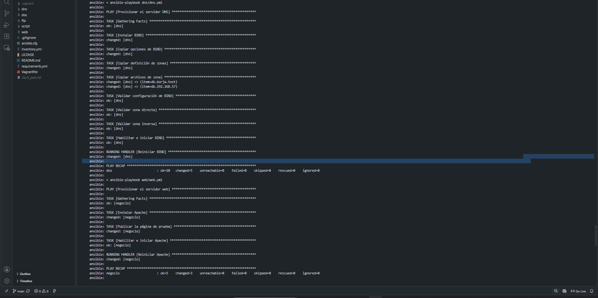


Los tres terminan con `failed=0`. Esta vez casi todo sale como `changed`, ya que las máquinas eran nuevas. En la salida también se ve que Vagrant sustituye la clave "insegura" que trae la imagen por una nueva para cada máquina (`Vagrant insecure key detected`), y por eso el script copia las claves después de que se hayan creado `dns` y `negocio`. También avisa de que las _guest additions_ de la imagen son más antiguas que mi versión de VirtualBox, pero la carpeta compartida `/vagrant` funciona correctamente.

Por último, pasé las pruebas:

```bash
vagrant ssh dns -c "bash /vagrant/dns/test-dns.sh"
```

```bash
vagrant ssh ansible -c "bash /vagrant/web/test-web.sh"
```

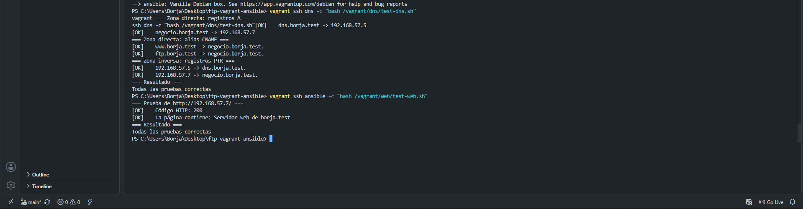

Todas salen en `[OK]`.

## 12. Conclusiones

En esta práctica he montado tres máquinas con Vagrant y las he configurado con Ansible desde un nodo de control: un DNS con BIND9 para `borja.test`, un servidor web con Apache y un FTP seguro con vsftpd, en el que `ana` puede publicar páginas y `juan` queda enjaulado en su carpeta. Todo se levanta con un único `vagrant up`.

Lo que más me ha servido entender:

- **Ansible frente a un script**: los playbooks describen el estado final de la máquina y no repiten lo que ya está hecho, algo que se ve claramente en las provisiones con `changed=0`. También he comprobado que dos playbooks pueden "pelearse" por el mismo fichero (los permisos del `index.html`), lo que rompe esa idea.
- **Ansible Vault**: las contraseñas se suben cifradas y la clave del vault se queda fuera del repositorio. Para que `vagrant up` funcione sin intervención, el script la copia desde `vault_pass.txt`.
- **vsftpd**: el modo independiente, solo IPv4, sin acceso anónimo, el enjaulado con lista de excepciones, la configuración por usuario para la carpeta de `ana` y TLS con un certificado autofirmado generado con `community.crypto`.
- **`ansible-lint`**: los tres playbooks pasan con el perfil `production`. En el del FTP tuve que sustituir el `ignore_errors` por una comprobación con `stat`.

Curiosamente, los problemas que más tiempo me llevaron no tuvieron que ver con la configuración de los servicios, sino con el entorno: la fecha de las máquinas al restaurarlas desde `saved`, VirtualBox bloqueado, el DNS de Windows preguntando por la tarjeta equivocada y, sobre todo, la falta de memoria. Con la memoria por defecto, `apt` y las actualizaciones del núcleo se quedaban sin RAM y el sistema mataba los procesos; con 2 GB por máquina se solucionó.

Al terminar dejé la red de mi ordenador como estaba al principio: quité el DNS de la tarjeta de VirtualBox y le devolví la métrica automática, porque con las máquinas apagadas hacía que las páginas web tardaran en cargar.

Todos los cambios están registrados en commits, y las 40 issues del tablero están cerradas.
