# FTP con Vagrant y Ansible paso a paso

Autor: Borja Valdearenas Cano

## 1. Introducción

En esta práctica monto tres máquinas virtuales con Vagrant (`dns`, `ansible` y `negocio`) y las configuro con Ansible. La máquina `ansible` es el nodo de control: desde ella se lanzan los playbooks que instalan el DNS en `dns` y el servidor web y el FTP seguro en `negocio`.

En este documento voy contando cada paso con sus comprobaciones. El objetivo, las herramientas y cómo arrancar el proyecto están en el [README principal](../README.md).

## 2. GitHub y gestión del proyecto

Creé el repositorio `ftp-vagrant-ansible` en GitHub y añadí al profesor (`frayaIzv`) como colaborador.

Para organizar el trabajo creé un proyecto en GitHub Projects con un tablero de tres columnas: **Por hacer**, **En progreso** y **Hecho**. Las columnas salen en inglés por defecto, así que les cambié el nombre y la descripción. Puse el proyecto público, porque los proyectos tienen permisos aparte del repositorio y así el profesor lo puede ver.

Después creé las issues del enunciado: 7 principales con 33 sub-issues, 40 en total. Cada una tiene el objetivo y la comprobación en la descripción, está asignada a mí y está añadida al tablero.


Cuando empiezo una tarea muevo su issue a **En progreso**. Al terminarla, pongo `Closes #N` en el mensaje del commit. GitHub la cierra sola al llegar el commit a `main`, y el tablero la pasa a **Hecho**. Si un commit resuelve varias issues hay que repetir `Closes` delante de cada número (`Closes #3, Closes #4`); si pones `Closes #3, #4` solo se cierra la primera.

## 3. Licencia

Añadí el fichero `LICENSE` desde GitHub con **Add file → Create new file**. Al escribir `LICENSE` como nombre sale el botón **Choose a license template**, que mete el texto completo de la licencia.

Elegí la **GNU GPL v3.0**, que es la misma que usa Ansible. Permite usar y modificar el proyecto, pero obliga a que las versiones modificadas que se distribuyan sigan siendo libres. GitHub la reconoce y la muestra en el apartado **About** del repositorio.

Commit: `Añadida licencia GPLv3 (Closes #1)`. Como lo hice en la web, luego hice `git pull` para tenerlo en mi ordenador.

## 4. README

El `README.md` de la raíz lo hice en tres commits, uno por cada parte, para cerrar cada sub-issue con su commit:

1. Título, autor e introducción (`Closes #3, Closes #4`).
2. Herramientas (`Closes #5`).
3. Cómo ejecutar el proyecto y licencia (`Closes #6, Closes #2`). Con este último cerré también la issue principal.

Más tarde el profesor actualizó el enunciado y la sub-issue de crear el README pasó a pedir también el nombre y la dirección del repositorio. Añadí la línea `Repositorio:` debajo del autor y actualicé la descripción de la issue #3. Como la issue ya estaba cerrada, en el commit puse `(#3)` en vez de `Closes #3`; así el commit aparece enlazado en la issue igualmente.

## 5. Vagrant

### 5.1. Fichero `.gitignore`

Antes de crear las máquinas añadí un `.gitignore` con la carpeta `.vagrant/`. Vagrant la crea al hacer `vagrant up` y dentro guarda las claves privadas de las máquinas, que no se deben subir al repositorio.

```text
# Carpeta de Vagrant con las máquinas y sus claves privadas
.vagrant/
```

Al hacer `git add` me salió este aviso:

```text
warning: in the working copy of '.gitignore', CRLF will be replaced by LF the next time Git touches it
```

No es un error. VS Code guardaba los ficheros con finales de línea de Windows (`CRLF`) y Git los guarda en el repositorio con los de Linux (`LF`). El problema es que Vagrant usa los ficheros de mi carpeta, no los del repositorio, y los ficheros que se copian a las máquinas Debian pueden dar problemas con `CRLF`. Para evitarlo cambié en VS Code la opción **Files: Eol** a `\n`, y así los ficheros nuevos se crean con `LF`.

### 5.2. Script `script/ansible.sh`

Este script prepara la máquina `ansible` como nodo de control. Lo ejecuta Vagrant solo en esa máquina:

- Instala `ansible`, `ansible-lint` y `whois` (este último trae `mkpasswd`, que usaré para las contraseñas del FTP).
- Copia las claves privadas de `dns` y `negocio` desde `/vagrant/.vagrant/...` a `private_keys/` y les pone permisos `600`. Si se usan directamente desde la carpeta compartida con Windows, salen con permisos abiertos y SSH se niega a usarlas.
- Copia los ficheros de Ansible y lanza los playbooks.

Como al principio no existen todos los ficheros, las líneas que los copian están comentadas. Las voy descomentando según los creo. Si no, el script fallaría al intentar copiar algo que no existe, porque empieza con `set -xeu`: `-e` para el script en el primer error, `-u` da error con variables sin definir y `-x` muestra cada comando antes de ejecutarlo.

Commit: `Añadido script/ansible.sh para preparar el nodo de control (Closes #12)`.

En la versión actualizada del enunciado, el script tiene un `chown` debajo de cada `cp`, en vez de dos `chown` al final con todos los ficheros. Así cada línea se puede descomentar por separado; con la versión anterior no podía activar `chown -R vagrant:vagrant ./{dns,web,ftp}` hasta tener las tres carpetas. Lo cambié igual que en el enunciado, pero con una corrección: después de copiar `requirements.yml`, el enunciado vuelve a hacer `chown ./inventory.yml`, y yo puse `chown ./requirements.yml`.

```bash
cp -vf /vagrant/requirements.yml .
chown vagrant:vagrant ./requirements.yml
```


Commit: `ansible.sh: un chown por cada fichero copiado, como en la versión actualizada del enunciado`.

### 5.3. Fichero `requirements.yml`

Lista las colecciones de Ansible que necesita el proyecto. Solo hay una, `community.crypto`, que trae los módulos para crear el certificado del FTP:

```yaml
---
collections:
  - name: community.crypto
```

Commit: `Añadido requirements.yml con la colección community.crypto (Closes #13)`.

Después descomenté en `ansible.sh` las dos líneas que lo usan: la que lo copia y la que instala las colecciones con `ansible-galaxy collection install -r requirements.yml`.

### 5.4. Fichero `Vagrantfile`

Define las tres máquinas con la imagen `debian/bookworm64` en la red privada `192.168.57.0/24`:

```ruby
Vagrant.configure("2") do |config|
  config.vm.box = "debian/bookworm64"

  config.vm.define "dns" do |dns|
    dns.vm.hostname = "dns.borja.test"
    dns.vm.network "private_network", ip: "192.168.57.5"
  end

  config.vm.define "negocio" do |negocio|
    negocio.vm.hostname = "negocio.borja.test"
    negocio.vm.network "private_network", ip: "192.168.57.7"
  end

  config.vm.define "ansible" do |ansible|
    ansible.vm.hostname = "ansible.borja.test"
    ansible.vm.network "private_network", ip: "192.168.57.6"
    ansible.vm.provision "shell", path: "script/ansible.sh"
  end
end
```

La máquina `ansible` va la última porque Vagrant crea las máquinas en orden, y su script copia las claves de `dns` y `negocio`. Si se creara antes, esas claves todavía no existirían.

La primera vez que hice `vagrant up` me salió esto:

```text
A Vagrant environment or target machine is required to run this
command. Run `vagrant init` to create a new Vagrant environment.
```

Había escrito mal el nombre del fichero. Tiene que llamarse exactamente `Vagrantfile`, con la `V` mayúscula y sin extensión. Lo renombré y ya funcionó.

### 5.5. Comprobaciones

Con `vagrant up` se crean las tres máquinas. En la salida se ve cómo el script instala Ansible, copia las claves e instala `community.crypto`.

```bash
vagrant status
```

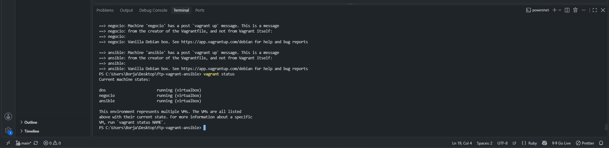

Salen las tres máquinas en `running`. En el enunciado pone que "deben aparecer las dos máquinas", pero son tres.

Para comprobar el nombre y la IP de cada máquina lanzo un comando en cada una sin entrar en ellas:

```bash
vagrant ssh dns -c "hostname -f; ip -4 -br addr show eth1"
```

```bash
vagrant ssh negocio -c "hostname -f; ip -4 -br addr show eth1"
```

```bash
vagrant ssh ansible -c "hostname -f; ip -4 -br addr show eth1"
```


Cada una tiene su nombre completo y su IP en `eth1`, la tarjeta de la red privada: `dns.borja.test` con `192.168.57.5`, `negocio.borja.test` con `192.168.57.7` y `ansible.borja.test` con `192.168.57.6`.

Commit: `Añadido Vagrantfile con las máquinas dns, negocio y ansible (Closes #8, Closes #9, Closes #10, Closes #11, Closes #7)`.

### 5.6. Problema: las máquinas se quedaban colgadas

Un día, al hacer `vagrant provision ansible`, el playbook del DNS se quedaba parado en `TASK [Instalar BIND]` y no avanzaba. En la máquina `dns` no había ningún proceso de `apt`, y luego tampoco respondía `vagrant ssh ansible -c "hostname"`. Al intentar reiniciarlas con `vagrant reload`, `dns` no respondía al apagado normal, así que las apagué a la fuerza:

```bash
vagrant halt -f
```

A la primera me dijo que otro proceso de Vagrant tenía bloqueada la máquina (`another process is already executing an action on the machine`). Era el `vagrant provision` que había cancelado, que seguía por detrás. Lo cerré desde el Administrador de tareas finalizando los procesos `ruby.exe`, que son los de Vagrant, y ya se apagaron.

Después reinicié Windows, y al hacer `vagrant up` me salió esto:

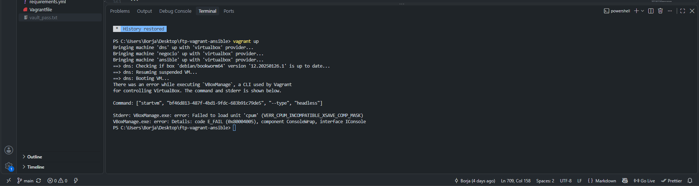

La máquina estaba en estado `saved` (se había guardado al reiniciar con ella encendida) y VirtualBox no podía continuarla: `VERR_CPUM_INCOMPATIBLE_XSAVE_COMP_MASK` quiere decir que el procesador no tenía la misma configuración que cuando se guardó. `vagrant status` daba `aborted-saved` en `dns` y `saved` en las otras dos. En VirtualBox, con clic derecho en cada máquina → **Descartar estado guardado**, las dejé en `poweroff` y ya arrancaron. No se pierde nada: lo descartado es lo que había en la memoria, no el disco.

Al volver a provisionar, en `Instalar BIND` salió esto:

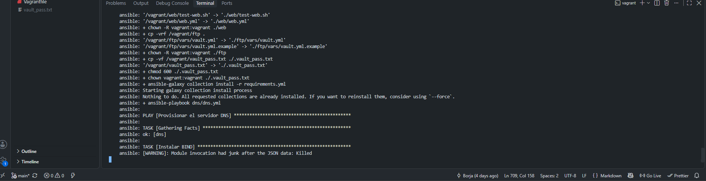

`Killed` quiere decir que Linux había matado el proceso. Miré la memoria de `dns` con `free -m`: no tenía _swap_, y cuando una máquina se queda sin RAM, Linux mata el proceso que más gasta. Con BIND funcionando y el `apt update`, la memoria por defecto ya no llegaba. Por eso se quedaba todo colgado.

En el `Vagrantfile` les di 1 GB a las tres máquinas. Al estar fuera de los `define`, vale para todas:

```ruby
  config.vm.provider "virtualbox" do |vb|
    vb.memory = 1024
  end
```


Ahora `total` es `960` (1 GB menos lo que reserva el sistema). Con esto la provisión terminó sin errores:


Por último pasé `test-dns.sh` y las 6 pruebas seguían en `[OK]`.

Commit: `Vagrantfile: 1024 MB de RAM para las máquinas, con la memoria por defecto apt se quedaba sin RAM`.

## 6. Ansible

Vagrant crea las máquinas y Ansible configura lo que va dentro. Con un script de Vagrant también se podría instalar todo, pero el script ejecuta los comandos uno detrás de otro y tiene que controlar él solo qué pasa si se ejecuta dos veces. Con Ansible las tareas se escriben en playbooks que dicen cómo tiene que quedar la máquina, y si algo ya está como debe, no lo vuelve a hacer.

### 6.1. Configuración SSH de las máquinas

Para saber con qué usuario y con qué clave entra Vagrant en cada máquina, ejecuto desde mi ordenador:

```bash
vagrant ssh-config
```


En los tres bloques el usuario es `vagrant` (`User vagrant`) y cada máquina tiene su propia clave privada (`IdentityFile`), dentro de `.vagrant/machines/<máquina>/virtualbox/private_key`.

También sale `HostName 127.0.0.1` con un puerto distinto en cada una (2222, 2200 y 2201). Así entra Vagrant desde mi ordenador, por la tarjeta NAT: usa el 2222 para la primera máquina y, como ya está ocupado, a las demás les da otro. Ansible no usa esto, porque está dentro de la red privada y entra directamente por las IPs `192.168.57.5` y `192.168.57.7`.

### 6.2. Fichero `ansible.cfg`

```ini
[defaults]
inventory = inventory.yml
remote_user = vagrant
host_key_checking = False
interpreter_python = auto_silent
```

En el repositorio el fichero tiene además un comentario encima de cada línea explicándola. Qué hace cada cosa:

- `inventory = inventory.yml`: el inventario por defecto, para no tener que poner `-i inventory.yml` en cada comando. En el enunciado se menciona esta línea en el apartado del inventario, pero no aparece en el ejemplo del `ansible.cfg`, así que la añadí.
- `remote_user = vagrant`: el usuario SSH, el mismo que usa Vagrant. Como es igual en todas las máquinas, lo pongo aquí una vez.
- `host_key_checking = False`: Ansible no comprueba la identidad del servidor SSH. La primera vez que te conectas a un servidor, SSH pregunta si confías en él y Ansible se quedaría esperando. Esto no tiene nada que ver con los certificados TLS. Solo vale para la práctica: en producción no te protegería si alguien se hace pasar por el servidor.
- `interpreter_python = auto_silent`: Ansible busca solo el Python de cada máquina sin mostrar avisos.

La clave privada no va en este fichero porque cada máquina tiene la suya; va en el inventario. Es la clave que genera Vagrant, que solo sirve para pruebas y no se sube al repositorio (por eso está `.vagrant/` en el `.gitignore`).

Al crear este fichero me equivoqué y pegué el contenido dentro de `script/ansible.sh`. Al hacer `git add ansible.cfg` me salió `fatal: pathspec 'ansible.cfg' did not match any files`, porque el fichero no existía. Con `git status` vi que `script/ansible.sh` salía como modificado; deshice el cambio y, cuando `git status` volvió a decir `working tree clean`, creé el `ansible.cfg` en su sitio.

Commit: `Añadido ansible.cfg con las opciones comunes documentadas (Closes #15)`.

### 6.3. Fichero `inventory.yml`

```yaml
all:
  hosts:
    dns:
      ansible_host: 192.168.57.5
      ansible_ssh_private_key_file: ./private_keys/dns.key.rsa
    negocio:
      ansible_host: 192.168.57.7
      ansible_ssh_private_key_file: ./private_keys/negocio.key.rsa
```

Igual que el `ansible.cfg`, en el repositorio tiene un comentario en cada máquina.

- `dns` y `negocio` son alias. Son los nombres que usaré en los playbooks (`hosts: dns`).
- `ansible_host` es la IP de cada máquina en la red privada.
- `ansible_ssh_private_key_file` es la clave de cada máquina, en la ruta donde la copia `ansible.sh`.
- La máquina `ansible` no está en el inventario porque es desde donde se lanzan los comandos, no una de las que se configuran.

Commit: `Añadido inventory.yml con las máquinas dns y negocio (Closes #16, Closes #14)`.

### 6.4. Copiar los ficheros a la máquina `ansible`

Descomenté en `script/ansible.sh` las líneas que copian `ansible.cfg` e `inventory.yml` y el `chown` que los pasa al usuario `vagrant`. El script se ejecuta como `root`, así que sin el `chown` los ficheros serían de `root`.

`vagrant up` solo ejecuta el script la primera vez, así que para volver a lanzarlo:

```bash
vagrant provision ansible
```

En la salida se ve la copia de los dos ficheros. También se ve que `apt-get` dice `already the newest version` y `ansible-galaxy` dice `Nothing to do`: no vuelven a instalar lo que ya está.

Entro en la máquina y miro los ficheros:

```bash
vagrant ssh ansible
```

```bash
ls -l
```

```bash
ls -l private_keys
```

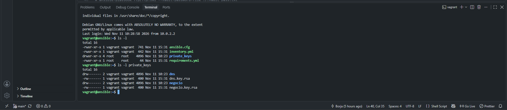

Los ficheros están en `/home/vagrant`. `ansible.cfg` e `inventory.yml` son de `vagrant`, y las claves tienen permisos `-rw-------` (600), que es lo que exige SSH. Los ficheros salen como ejecutables (`-rwxr-xr-x`) porque la carpeta compartida con Windows (`/vagrant`) no guarda los permisos de Linux y `cp` los copia así; no afecta a nada. Las carpetas vacías `dns` y `negocio` las crea el `mkdir` del script, pero no se usan.

Commit: `ansible.sh: copiar ansible.cfg e inventory.yml al nodo de control`.

### 6.5. Comprobaciones

Ansible lee el inventario:

```bash
ansible-inventory --graph
```


Salen `dns` y `negocio` dentro de `@all`, en `@ungrouped` porque no están en ningún grupo propio. No he puesto `-i inventory.yml` y lo ha encontrado igual, así que también está leyendo el `ansible.cfg`.

Para comprobarlo del todo, ejecuté también el comando tal cual viene en el enunciado, con `-i`, y el mismo sin él:

```bash
ansible-inventory -i inventory.yml --graph
```

```bash
ansible-inventory --graph
```

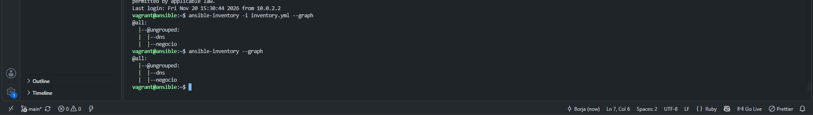

Los dos dan lo mismo, porque `inventory = inventory.yml` en `ansible.cfg` hace de `-i` por defecto.

Conexión con las dos máquinas:

```bash
ansible all -m ping
```


Las dos responden `SUCCESS` con `pong`. Este `ping` no es el del sistema (no envía paquetes ICMP): entra por SSH, comprueba que hay Python y responde. En `discovered_interpreter_python` se ve el Python que ha encontrado, `/usr/bin/python3`. `negocio` sale antes que `dns` porque Ansible se conecta a las dos a la vez y muestra primero la que responde antes.

Comando con privilegios de `root`:

```bash
ansible all -b -a "uptime"
```


`-a` ejecuta un comando con el módulo `command`, y `-b` (_become_) lo hace con `sudo`. Las dos dan `rc=0`, así que el usuario `vagrant` puede usar `sudo`. Sale `CHANGED` porque con `command` Ansible no sabe si el comando ha cambiado algo, así que siempre lo marca como cambiado.

## 7. Servidor DNS

El DNS es el mismo tipo de servidor que monté en la práctica anterior con BIND9, pero esta vez no lo configuro a mano: escribo los ficheros en el repositorio y un playbook de Ansible los copia y lo deja funcionando.

Todo va en la carpeta `dns/`:

```text
dns/
├── dns.yml
├── test-dns.sh
└── files/
    ├── named.conf.options
    ├── named.conf.local
    ├── db.borja.test
    └── db.192.168.57
```

### 7.1. Ficheros de BIND

Cada fichero lo creé y lo subí con su propio commit.

**`named.conf.options`**:

```text
acl confiables {
    127.0.0.1;
    192.168.57.0/24;
};

options {
    directory "/var/cache/bind";
    allow-transfer { none; };
    listen-on port 53 { 127.0.0.1; 192.168.57.5; };
    listen-on-v6 { none; };
    recursion yes;
    allow-recursion { confiables; };
    dnssec-validation auto;
};
```

Es casi igual que el de la práctica anterior, con la red `57` en vez de la `56`. La recursión solo se permite al propio servidor y a la red privada, como pide el enunciado. Hay dos cambios:

- En la práctica anterior limitaba BIND a IPv4 con `-4` en `/etc/default/named`. Aquí lo hago con `listen-on-v6 { none; }` en las opciones y así no hace falta copiar otro fichero.
- Uso `dnssec-validation auto`, que es el valor que trae Debian: BIND valida DNSSEC con la clave de la raíz que trae incluida.

**`named.conf.local`** declara las dos zonas. Las rutas son las de `/var/lib/bind/`, que es donde el playbook copia las zonas:

```text
zone "borja.test" {
    type master;
    file "/var/lib/bind/db.borja.test";
};

zone "57.168.192.in-addr.arpa" {
    type master;
    file "/var/lib/bind/db.192.168.57";
};
```

**`db.borja.test`**, la zona directa:

```text
$TTL 86400
@   IN SOA dns.borja.test. admin.borja.test. (
        2026111301 ; Serial
        3600       ; Refresh
        1800       ; Retry
        604800     ; Expire
        86400 )    ; Negative Cache TTL
;
@        IN NS     dns.borja.test.
dns      IN A      192.168.57.5
negocio  IN A      192.168.57.7
www      IN CNAME  negocio.borja.test.
ftp      IN CNAME  negocio.borja.test.
```

`www` y `ftp` son alias de `negocio`: así el navegador va a `www.borja.test`, FileZilla a `ftp.borja.test`, y los dos acaban en la misma máquina.

**`db.192.168.57`**, la zona inversa, con un PTR por cada máquina. El número es el último octeto de la IP:

```text
@   IN NS   dns.borja.test.
5   IN PTR  dns.borja.test.
7   IN PTR  negocio.borja.test.
```

`www` y `ftp` no tienen PTR porque son alias: la IP `.7` apunta al nombre real de la máquina, `negocio.borja.test`.

Los dos ficheros de zona terminan con un salto de línea. En la práctica anterior `named-checkzone` me avisaba de `file does not end with newline`, así que esta vez lo puse desde el principio.

### 7.2. Playbook `dns/dns.yml`

Es el del enunciado con `equipo` cambiado por `borja`. Lo único que añadí es el paquete `bind9-dnsutils`, que trae `dig` y `nslookup` para el script de pruebas.

Qué hace:

1. Instala `bind9` y `bind9-dnsutils` con el módulo `apt`.
2. Copia `named.conf.options` y `named.conf.local` a `/etc/bind/`.
3. Copia las dos zonas a `/var/lib/bind/` con dueño `bind`, para que BIND las pueda leer. Lo hace con una sola tarea y un `loop` que recorre los dos ficheros.
4. Comprueba la configuración con `named-checkconf` y cada zona con `named-checkzone`, los mismos comandos que usé a mano en la práctica anterior. Si hay un error, el playbook se para antes de reiniciar BIND.
5. Deja BIND habilitado y arrancado.

Las tareas que copian ficheros tienen `notify: Reiniciar BIND`. Si alguna cambia algo, avisa al _handler_, que reinicia BIND una sola vez al final. Las tareas de comprobación llevan `changed_when: false` porque no cambian nada; sin eso Ansible las marcaría siempre como `changed`, igual que pasó con `uptime`.

Para que se ejecute, descomenté en `script/ansible.sh` la línea que copia la carpeta `dns` y la que lanza `ansible-playbook dns/dns.yml`. La línea `chown -R vagrant:vagrant ./{dns,web,ftp}` la dejé comentada, porque `web` y `ftp` todavía no existen y, con `set -e`, el script se pararía.

### 7.3. Problema: la fecha de las máquinas

Al día siguiente, `vagrant status` me decía que las máquinas estaban en `saved`. Las arranqué con `vagrant up` y lancé `vagrant provision ansible`, pero falló el `apt-get update`:

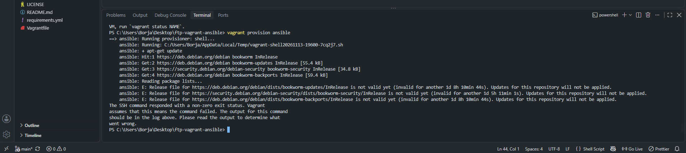

`apt` decía que los ficheros de Debian "todavía no eran válidos" (`is not valid yet`). Miré la fecha de la máquina:

```bash
vagrant ssh ansible -c "date"
```

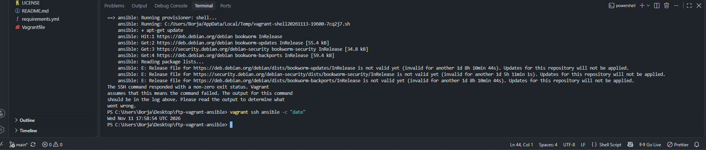

Tenía la fecha del día que dejé de trabajar. El estado `saved` es como suspender el ordenador: VirtualBox guarda la máquina tal cual y el reloj se queda congelado. Al despertarla seguía con esa hora, y para ella los ficheros de Debian venían "del futuro". Como el script tiene `set -e`, en cuanto falló `apt-get update` se paró.

Lo arreglé reiniciando las tres máquinas, que al arrancar cogen la hora del ordenador:

```bash
vagrant reload
```


Ahora, antes de apagar el ordenador, apago las máquinas con `vagrant halt` para que no se queden en `saved`.

### 7.4. Ejecución del playbook

```bash
vagrant provision ansible
```

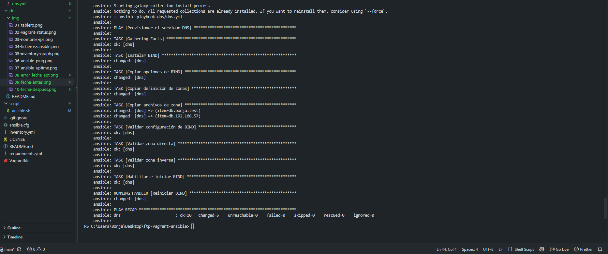

El resumen da `ok=10 changed=5 failed=0`. Las 5 tareas `changed` son la instalación, las tres copias de ficheros y el reinicio. Las comprobaciones salen `ok` gracias al `changed_when: false`. El _handler_ `Reiniciar BIND` se ejecuta una sola vez al final, aunque lo avisaron tres tareas.

Para comprobar que Ansible analiza el playbook sin errores, dentro de la máquina `ansible`:

```bash
ansible-playbook dns/dns.yml --syntax-check
```

```bash
ansible-lint dns/dns.yml
```

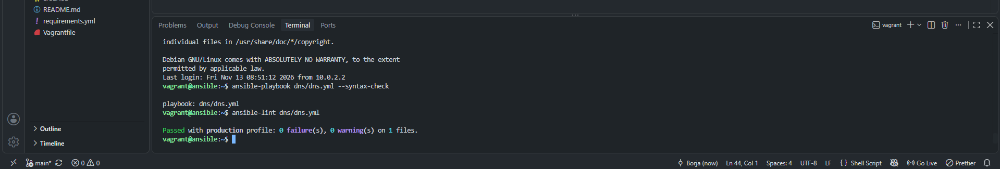

`--syntax-check` solo comprueba que el YAML y la estructura son correctos, sin ejecutar nada. `ansible-lint` revisa además buenas prácticas, y pasa con el perfil `production`, que es el más estricto, con 0 fallos y 0 avisos.

El playbook también se puede lanzar a mano desde el nodo de control, como viene en el enunciado. Dentro de la máquina `ansible`:

```bash
ansible-playbook -i inventory.yml dns/dns.yml
```

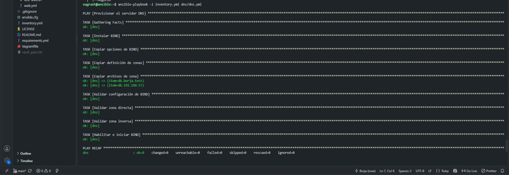

Sale `changed=0`, porque el DNS ya estaba configurado. Es lo mismo que hace el script con `vagrant provision`, pero lanzado por mí desde `ansible`.

Commits: uno para el playbook y otro para el cambio en `ansible.sh`.

### 7.5. Script de pruebas `dns/test-dns.sh`

El script pregunta a `192.168.57.5` con `dig ... +short` y compara cada respuesta con la que espera:

- Registros A: `dns` y `negocio`.
- CNAME: `www` y `ftp`, que tienen que apuntar a `negocio.borja.test.`.
- PTR: `192.168.57.5` y `192.168.57.7`.

Si coincide escribe `[OK]` y si no `[FALLO]`. Al final termina con código `0` si todo ha ido bien o con el número de fallos. En la práctica anterior el `test.sh` solo mostraba las respuestas y tenía que revisarlas yo; este las comprueba solo.

Lo ejecuto en la máquina `dns`, que es la que tiene `dig`:

```bash
vagrant ssh dns -c "bash /vagrant/dns/test-dns.sh"
```

La primera vez me salió esto:

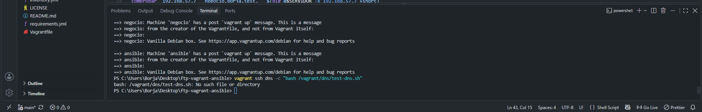

Con `ls dns` vi que había llamado al fichero `test.dns.sh`, con punto en vez de guion. Lo renombré a `test-dns.sh`:

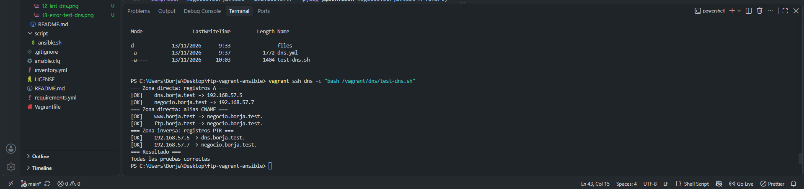

Las 6 pruebas salen `[OK]`.

Commit: `DNS: añadido script de pruebas de los registros directos e inversos (Closes #18, Closes #19, Closes #20, Closes #21, Closes #22, Closes #23, Closes #24, Closes #17)`. Con el script se comprueban todas las sub-issues del DNS, así que las cerré todas con este commit.

### 7.6. DNS en mi ordenador

Para poder usar `www.borja.test` en el navegador y `ftp.borja.test` en FileZilla, puse mi servidor como DNS de Windows. En **Conexiones de red** (`ncpa.cpl`) → adaptador Ethernet → **Propiedades** → **TCP/IPv4**:

- DNS preferido: `192.168.57.5`
- DNS alternativo: `8.8.8.8`


El alternativo lo añadí yo, para no quedarme sin Internet cuando las máquinas están apagadas: si el primero no responde, Windows usa el segundo. Antes lo tenía en automático; cuando termine la práctica lo dejaré como estaba.

Lo compruebo desde Windows sin indicar el servidor, para ver que lo usa solo:

```bash
nslookup www.borja.test
```

```bash
nslookup ftp.borja.test
```


Responde `dns.borja.test` (`192.168.57.5`): sale el nombre del servidor porque `nslookup` lo ha sacado de mi zona inversa. `www` y `ftp` aparecen como alias de `negocio.borja.test` con la IP `192.168.57.7`.

También probé un nombre de Internet:

```bash
nslookup www.google.es
```


Las dos primeras veces dio `DNS request timed out`. Para un nombre de fuera, mi servidor tiene que ir preguntando desde los servidores raíz y además validar DNSSEC, y la primera vez tardaba más de los 2 segundos que espera `nslookup`. A la tercera ya lo tenía en caché y respondió. Sale `Respuesta no autoritativa` porque mi servidor no es el dueño de `google.es`: lo ha conseguido por recursión. Es lo mismo que la flag `aa` de la práctica anterior.

Más adelante, al probar la web en el navegador, vi que esta configuración no bastaba: `nslookup` funcionaba pero el navegador no. Lo explico en el apartado 8.6.

## 8. Servidor web

El servidor web va en `negocio`, igual que el FTP. Todo está en la carpeta `web/`:

```text
web/
├── web.yml
├── test-web.sh
└── files/
    └── index.html
```

### 8.1. Página y playbook

`files/index.html` es una página sencilla con un texto que luego busca el script de pruebas:

```html
<h1>Servidor web de borja.test</h1>
```

El playbook `web.yml` es el del enunciado: instala `apache2`, copia la página a `/var/www/html/` y deja Apache habilitado y arrancado. Si la página cambia, un _handler_ reinicia Apache al final, igual que con BIND.

Al crear `web.yml` hice clic derecho sobre la carpeta y se me creó dentro de `files`. VS Code muestra `web\files` en una sola línea cuando `files` es lo único que hay dentro, y al hacer clic ahí el fichero se crea en `files`. Lo moví con:

```bash
Move-Item web/files/web.yml web/
```

Commits: uno para `index.html` y otro para `web.yml`.

### 8.2. Cambios en `ansible.sh`

Descomenté la línea que copia la carpeta `web` y la que lanza `ansible-playbook web/web.yml`.

Para la prueba con `curl` necesitaba ese programa en la máquina `ansible`, pero `which curl` no devolvía nada: la imagen de Debian no lo trae. Lo añadí a la línea de instalación del script:

```bash
apt-get install -y ansible ansible-lint whois curl
```

Commit: `ansible.sh: instalar curl, copiar la carpeta web y ejecutar el playbook web`.

### 8.3. Ejecución

```bash
vagrant provision ansible
```

Ahora se ejecutan los dos playbooks. El del DNS sale así:


Todas las tareas salen en `ok` y el resumen es `changed=0`. Como no había cambiado nada del DNS, Ansible no ha tocado nada y el _handler_ no se ha ejecutado, así que BIND no se ha reiniciado. Es la ventaja frente a un script: se puede ejecutar todas las veces que haga falta y solo cambia lo necesario.

El de la web:


`ok=5 changed=3 failed=0`: instala Apache, copia la página y lo reinicia con el _handler_.

Igual que con el DNS, lo lancé también a mano desde la máquina `ansible`:

```bash
ansible-playbook -i inventory.yml web/web.yml
```


Como ya estaba todo hecho, sale `changed=0`.

### 8.4. Comprobaciones del servidor

Dentro de la máquina `ansible`:

```bash
ansible-playbook web/web.yml --syntax-check
```

```bash
ansible-lint web/web.yml
```


Igual que el del DNS, pasa con el perfil `production` sin fallos ni avisos.

Para ver que Apache está funcionando lo pregunto con Ansible, solo a `negocio`:

```bash
ansible negocio -b -a "systemctl is-active apache2"
```


Responde `active`.

### 8.5. Script de pruebas `web/test-web.sh`

El script descarga la página con `curl` y comprueba dos cosas:

- Que el código HTTP es `200`. Lo saca con `curl -s -w "\n%{http_code}"`, que añade el código en una última línea.
- Que la página contiene el texto `Servidor web de borja.test`, con `grep -q`. Así sé que Apache sirve mi página y no la de bienvenida que trae por defecto.

Tiene la misma estructura que `test-dns.sh`: `[OK]` o `[FALLO]` en cada prueba y termina con el número de fallos.

Uso la IP `192.168.57.7` y no `www.borja.test` porque las máquinas virtuales no usan mi servidor DNS, sino el de la red NAT de VirtualBox. El nombre lo pruebo desde el navegador de mi ordenador.

```bash
vagrant ssh ansible -c "bash /vagrant/web/test-web.sh"
```

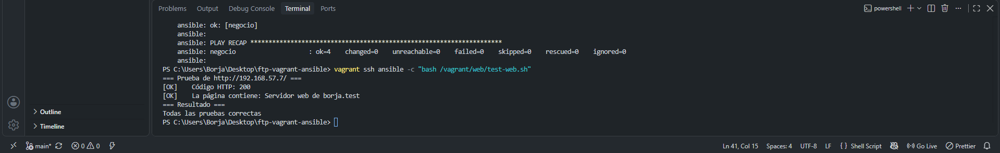

Commit: `Web: añadido script de prueba con curl (Closes #26, Closes #27, Closes #28, Closes #25)`.

### 8.6. Problema: el navegador no encontraba `www.borja.test`

Al abrir `http://www.borja.test` en el navegador me salió esto:

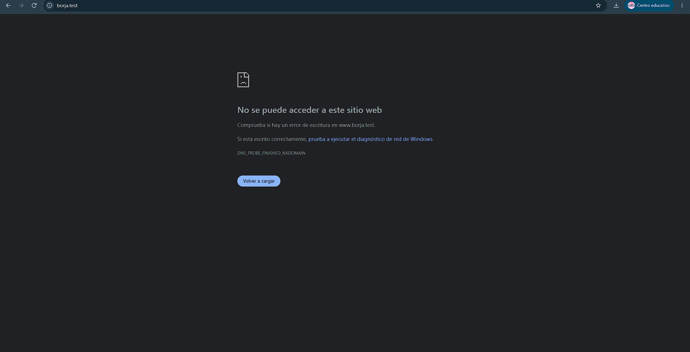

`DNS_PROBE_FINISHED_NXDOMAIN` quiere decir que el nombre no existe. Pero con `nslookup` sí funcionaba (apartado 7.6). Para ver lo mismo que ve el navegador usé `Resolve-DnsName`, que usa el resolvedor de Windows:

```bash
Resolve-DnsName www.borja.test
```


Windows tampoco lo encontraba. La diferencia es que `nslookup` pregunta directamente al primer servidor DNS de la lista, y el resolvedor de Windows no. Con `Get-DnsClientServerAddress` vi los DNS de cada tarjeta, y fui probando:

1. Además del cable (tarjeta `Ethernet`), tenía la Wi-Fi conectada, con el DNS del router (`192.168.1.1`). La desconecté, pero seguía igual.
2. Quité el `8.8.8.8` del DNS alternativo, y el error cambió: ya no era "no existe" sino "se agotó el tiempo de espera". O sea, el "no existe" lo respondía `8.8.8.8`, y mi servidor no llegaba a contestar.
3. Con `Resolve-DnsName www.borja.test -Server 192.168.57.5` sí funcionaba.

El problema era desde qué tarjeta salía la pregunta. Había puesto el DNS en la tarjeta `Ethernet`, la de mi red de casa, así que Windows enviaba la pregunta con la IP de esa tarjeta. La red de las máquinas es otra, la de VirtualBox, y la respuesta no volvía por el mismo camino. Con `-Server` o con `nslookup`, Windows busca el camino hasta `192.168.57.5` y sale por la tarjeta de VirtualBox, por eso sí funcionaba.

Busqué qué tarjeta tiene la IP de mi ordenador en esa red:

```bash
Get-NetIPAddress -AddressFamily IPv4 | Where-Object IPAddress -like "192.168.57.*"
```

Es `Ethernet 4`, con `192.168.57.1` (las otras dos tarjetas de VirtualBox que tengo son de otras redes). Así que lo dejé así:

- `Ethernet` (el cable) con el DNS en automático, como estaba. Así, si apago las máquinas, sigo teniendo Internet.
- `Ethernet 4` con DNS `192.168.57.5` y la **métrica** de la interfaz a `1` (en **Opciones avanzadas**, quitando **Métrica automática**). La métrica es la prioridad de la tarjeta: con `1`, Windows pregunta primero a mi servidor.
- La Wi-Fi también en automático.

La primera vez puse en `Ethernet 4` el DNS `192.168.57.1`, que es la IP de mi ordenador y no la del servidor. Lo vi en `Get-DnsClientServerAddress` y lo corregí:


Después de vaciar la caché con `ipconfig /flushdns` (en una terminal de administrador, porque si no da "La operación solicitada requiere elevación"):

```bash
Resolve-DnsName www.borja.test
```


Ahora Windows lo resuelve solo: `www.borja.test` es un CNAME de `negocio.borja.test`, con la IP `192.168.57.7`.

Y en el navegador ya carga la página:


Chrome oculta por defecto el `http://` y el `www.` de la barra de direcciones; para que se vea la dirección completa marqué **Mostrar siempre URLs completas** con clic derecho en la barra.

## 9. Servidor FTP

El FTP va en `negocio`, junto a Apache. Lo monto con `vsftpd`, con dos usuarios locales (`juan` y `ana`) y conexiones cifradas con TLS.

### 9.1. Contraseñas con Ansible Vault

El módulo `ansible.builtin.user` necesita el **hash** de la contraseña, no la contraseña en claro. Los generé en la máquina `ansible` con `mkpasswd`, que viene en el paquete `whois` que instala el script:

```bash
mkpasswd --method=sha-512
```


La contraseña se escribe cuando la pide, no como argumento, para que no quede en el historial de la terminal. El hash empieza por `$6$`, que indica SHA-512; lo que va entre el segundo y el tercer `$` es la _salt_, un valor aleatorio, por eso cada vez sale un hash distinto aunque la contraseña sea la misma. Generé uno para `juan` (contraseña `juan`) y otro para `ana` (contraseña `ana`).

Los hashes van en `ftp/vars/vault.yml`, cifrado con Ansible Vault con la contraseña `daw`:

```bash
EDITOR=nano ansible-vault create /vagrant/ftp/vars/vault.yml
```

Lo creo en `/vagrant`, que es la carpeta del proyecto, para que aparezca en el repositorio. Uso `nano` porque el editor que abre por defecto es `vi`. La primera vez cerré la terminal sin querer antes de guardar, y al repetirlo me decía `vault.yml exists, please use 'edit' instead`, porque el fichero ya se había creado a medias. Lo borré con `rm` y lo creé otra vez.

```bash
head -n 3 /vagrant/ftp/vars/vault.yml
```

```bash
ansible-vault view /vagrant/ftp/vars/vault.yml
```

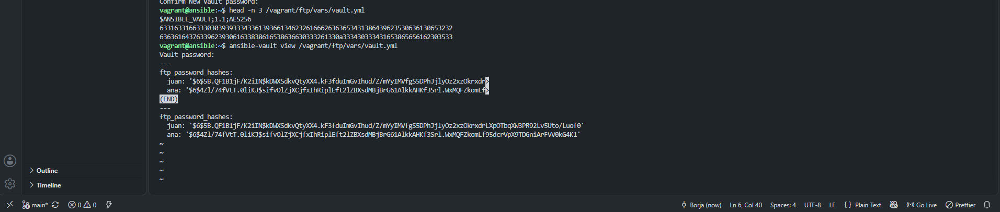

Con `head` se ve el fichero tal como está guardado: la cabecera `$ANSIBLE_VAULT;1.1;AES256` y el contenido cifrado. Con `ansible-vault view` y la contraseña se ven los hashes. `view` lo enseña con `less`, así que para salir hay que pulsar `q`.

El fichero `vault.yml` sí se sube al repositorio, porque está cifrado. Además subí `ftp/vars/vault.yml.example`, sin cifrar y con marcadores en lugar de hashes, para que se vea la estructura.

La contraseña `daw` está en `vault_pass.txt`, en la raíz del proyecto, para que el script la copie a la máquina `ansible` y el playbook pueda leer el vault sin pedirla. Ese fichero está en el `.gitignore` y no se sube. Lo añadí al `.gitignore` antes de crearlo, para no subirlo por error.

En `script/ansible.sh` descomenté la copia de la carpeta `ftp`, el `chown -R` de las tres carpetas (que hasta ahora no podía activar porque faltaban `web` y `ftp`) y la copia de la contraseña a `.vault_pass.txt` con permisos `600`. Le añadí un `chown vagrant:vagrant`, porque si no el fichero es de `root` y, entrando como `vagrant`, no podría usarlo para lanzar el playbook a mano.

```bash
vagrant ssh ansible -c "ls -l .vault_pass.txt; ansible-vault view ftp/vars/vault.yml --vault-password-file .vault_pass.txt"
```


El fichero es de `vagrant`, tiene permisos `-rw-------` y ocupa 3 bytes (`daw`). Con `--vault-password-file` el vault se descifra sin escribir la contraseña.

### 9.2. Playbook `ftp/ftp.yml`

Es el del enunciado actualizado. El único hueco era el dominio: `domain_name: "borja.test"`. Hace esto:

- Instala `vsftpd` y `python3-cryptography`, que es lo que necesita `community.crypto` en `negocio` para crear el certificado.
- Crea los grupos `ftpusers` y `webpublish`, y los usuarios `juan` y `ana` con el hash de su contraseña sacado del vault (`ftp_password_hashes[item]`). Los dos están en `ftpusers` y solo `ana` en `webpublish`.
- Deja `/var/www/html` con dueño `root`, grupo `webpublish` y permisos `2775`. El `2` es el bit _setgid_: lo que se cree dentro hereda el grupo `webpublish`.
- Da permisos `0664` y grupo `webpublish` al `index.html`, para que `ana` lo pueda sobrescribir.
- Genera el certificado en tres pasos: la clave privada, el CSR (con `ftp.borja.test` y `www.borja.test` como nombres alternativos) y el certificado autofirmado para un año. Van en `/etc/ssl/ftp/`. En el texto del enunciado pone `/etc/ssl/equipo/vsftpd.crt`, pero las rutas que valen son las del playbook, que es quien los crea.
- Copia `vsftpd.chroot_list` y `vsftpd.conf`, y reinicia vsftpd con un _handler_ si cambian.

Commit: `FTP: añadido el playbook ftp.yml con los usuarios, los grupos y el certificado`.

### 9.3. `vsftpd.chroot_list` y `vsftpd.conf`

`ftp/files/vsftpd.chroot_list` solo tiene una línea: `ana`. Es la lista de usuarios que **no** se enjaulan.

En `vsftpd.conf` rellené los huecos del enunciado:

| Hueco                      | Lo que puse                                                                                      |
| -------------------------- | ------------------------------------------------------------------------------------------------ |
| Modo independiente IPv4    | `listen=YES` y `listen_ipv6=NO`                                                                  |
| Acceso con cuentas locales | `anonymous_enable=NO`, `local_enable=YES` y `write_enable=YES`                                   |
| Enjaular excepto a ana     | `chroot_local_user=YES`, `chroot_list_enable=YES` y `chroot_list_file=/etc/vsftpd.chroot_list`   |
| Certificados               | `rsa_cert_file=/etc/ssl/ftp/borja.test.crt` y `rsa_private_key_file=/etc/ssl/ftp/borja.test.key` |

Con `chroot_local_user=YES` se enjaula a todos los usuarios locales en su carpeta personal, y con `chroot_list_enable=YES` los de la lista son la excepción. Así `juan` queda enjaulado y `ana` no.

El enunciado pide buscar qué significa `allow_writeable_chroot=YES`. Por seguridad, vsftpd no deja enjaular a un usuario en una carpeta en la que pueda escribir, y da el error `refusing to run with writable root inside chroot()`. Con `YES` lo permite. Hace falta porque la carpeta de `juan` es suya y puede escribir en ella.

Añadí también algunas opciones que no eran huecos:

- `pam_service_name=vsftpd` y `secure_chroot_dir=/var/run/vsftpd/empty`. Este fichero sustituye entero al de Debian, y esas dos opciones venían en el original; sin ellas, vsftpd usa otros valores que en Debian no funcionan.
- `ssl_sslv2=NO` y `ssl_sslv3=NO`, porque el comentario del enunciado dice "sin SSL obsoleto".

Al crear `vsftpd.conf` escribí la ruta `ftp/files/vsftpd.conf` con la carpeta `files` seleccionada, y VS Code lo creó en `ftp/files/ftp/files/vsftpd.conf`. Lo moví con `Move-Item` y borré las carpetas que sobraban con `Remove-Item ftp/files/ftp -Recurse`. Al moverlo se perdió lo que había pegado sin guardar y lo tuve que volver a pegar.

Commits: uno para `vsftpd.chroot_list` y otro para `vsftpd.conf`.

### 9.4. La carpeta de `ana` en `/var/www/html`

El enunciado pide que la raíz FTP de `ana` sea `/var/www/html`. Como no está enjaulada, `ana` podía ir a esa carpeta, pero al conectarse empezaba en `/home/ana`. vsftpd permite configurar cada usuario por separado: en `vsftpd.conf` añadí `user_config_dir=/etc/vsftpd_user_conf`, y en esa carpeta va un fichero con el nombre de cada usuario. El de `ana` (`ftp/files/vsftpd_user_conf/ana`) tiene:

```text
local_root=/var/www/html
```

En el playbook añadí una tarea que copia esa carpeta:

```yaml
- name: Copiar la configuración propia de cada usuario (raíz FTP de ana)
  ansible.builtin.copy:
    src: files/vsftpd_user_conf/
    dest: /etc/vsftpd_user_conf/
    owner: root
    group: root
    mode: "0644"
    directory_mode: "0755"
  notify: Reiniciar vsftpd
```

La barra al final de `src` hace que se copie lo que hay dentro de la carpeta y no la carpeta entera.

Commit: `FTP: la raíz FTP de ana es /var/www/html con una configuración propia por usuario`.

### 9.5. Ejecución y problemas de memoria

Descomenté en `ansible.sh` la última línea, la del playbook del FTP con `--vault-password-file ./.vault_pass.txt`, y lancé `vagrant provision ansible`. Falló en el `apt-get install` del script:

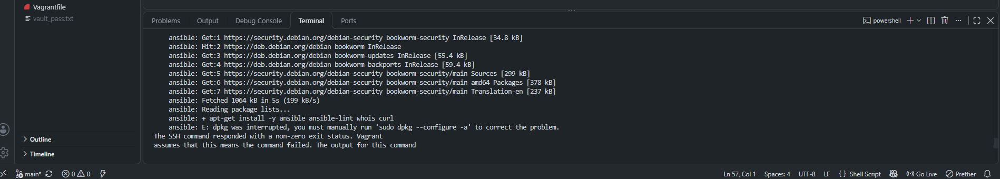

`dpkg` se había quedado a medias el día que apagué las máquinas a la fuerza. Lo arreglé con `sudo dpkg --configure -a` en las tres máquinas, pero en `ansible` faltaba terminar una actualización del núcleo de Linux, y al generar su fichero de arranque el proceso salió `Killed`:


Otra vez por falta de memoria: con 1 GB no le llegaba. Le di 2 GB a `ansible` y `dpkg --configure -a` terminó bien:

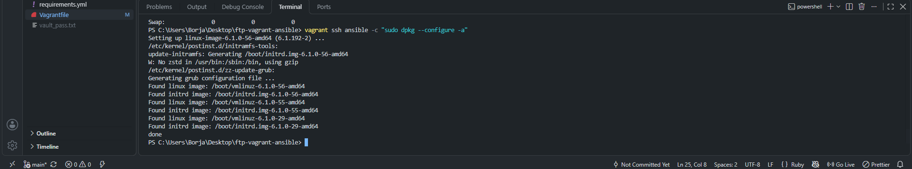

Más tarde le pasó lo mismo a `negocio`: se colgó al hacer `vagrant ssh` y también tenía el núcleo a medias. Como mi ordenador tiene 32 GB, puse 2 GB para las tres máquinas en el bloque general del `Vagrantfile` y quité el bloque que había puesto solo para `ansible`.

Con esto el playbook del FTP funcionó:


`ok=17 changed=15 failed=0`. Sale el aviso `Collection community.crypto does not support Ansible version 2.14.18`: `ansible-galaxy` instala la última versión de la colección, pensada para versiones de Ansible más nuevas que la de Debian. Funciona igual: el certificado se crea.

### 9.6. `ansible-lint` del playbook FTP

Al pasar `ansible-lint ftp/ftp.yml` salió `Attempting to decrypt but no vault secrets found`: `ansible-lint` hace por dentro un `--syntax-check` y no tenía la contraseña del vault. No tiene opción para dársela, pero se puede con una variable de entorno:

```bash
ANSIBLE_VAULT_PASSWORD_FILE=.vault_pass.txt ansible-lint ftp/ftp.yml
```

Así ya analizó el playbook y encontró un fallo:


La tarea que da permisos al `index.html` tenía `ignore_errors: true`, por si el fichero todavía no existe. `ansible-lint` lo considera mala práctica, porque ignora cualquier error, también los que no esperas, y el playbook se quedaba en el perfil `safety` con 3 de 5 estrellas. Lo cambié por una comprobación previa:

```yaml
- name: Comprobar si existe la página de prueba
  ansible.builtin.stat:
    path: /var/www/html/index.html
  register: pagina_prueba

- name: Asignar permisos al archivo de prueba para el grupo webpublish
  ansible.builtin.file:
    path: /var/www/html/index.html
    owner: root
    group: webpublish
    mode: "0664"
    state: file
  when: pagina_prueba.stat.exists
```

`stat` mira el fichero sin cambiar nada y la tarea siguiente solo se ejecuta si existe.

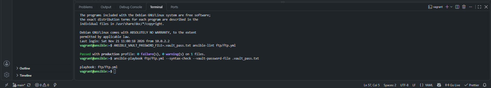

Ahora pasa con el perfil `production`, igual que el DNS y la web.

Commit: `FTP: comprobar si existe index.html en vez de ignore_errors, para pasar ansible-lint (Closes #30)`.

### 9.7. Los playbooks de la web y del FTP se contradicen

Al volver a provisionar, sin cambiar nada, salía esto:


`Publicar la página de prueba` (web) deja el `index.html` como `root:root 0644`, y `Asignar permisos al archivo de prueba` (FTP) lo deja como `root:webpublish 0664`. En cada provisión uno lo cambia y el otro lo vuelve a cambiar, así que siempre salen `changed` y Apache se reinicia sin necesidad. Además, si `ana` sube una página y después se provisiona, el playbook de la web la sobrescribe con la del repositorio. Por eso hice las pruebas con FileZilla sin volver a provisionar.

También sale siempre `changed` en `Generar Solicitud de Firma de Certificado (CSR)`: `openssl_csr_pipe` genera el CSR en memoria cada vez. El certificado sale `ok` y no se vuelve a crear.

### 9.8. Comprobaciones en `negocio`

```bash
vagrant ssh negocio -c "systemctl status vsftpd --no-pager"
```


Está `enabled` y `active (running)`, y el proceso es `/usr/sbin/vsftpd /etc/vsftpd.conf`: funciona por sí mismo, en modo independiente.

```bash
vagrant ssh negocio -c "sudo ss -tlnp | grep ':21 '; dpkg -l | grep -i inetd || echo 'inetd no está instalado'"
```


Escucha en `0.0.0.0:21`, que es solo IPv4 (no hay ninguna línea con `[::]:21`), y `inetd` no está instalado.

```bash
vagrant ssh negocio -c "id juan; id ana; ls -ld /var/www/html; ls -l /var/www/html/index.html"
```


`juan` está en `ftpusers` y `ana` en `ftpusers` y `webpublish`. `/var/www/html` es `drwxrwsr-x` con grupo `webpublish` (la `s` es el _setgid_) y el `index.html` es `-rw-rw-r--`.

```bash
vagrant ssh negocio -c "sudo openssl x509 -in /etc/ssl/ftp/borja.test.crt -noout -subject -issuer -dates -ext subjectAltName"
```


`subject` e `issuer` son iguales, así que es autofirmado. Vale un año y sus nombres son `borja.test`, `ftp.borja.test` y `www.borja.test`.

## 10. Pruebas con FileZilla

Al descargar FileZilla, Windows bloqueó el instalador porque era la versión _sponsored_, que trae software publicitario. Descargué la versión sin publicidad desde la lista completa de descargas (`download.php?show_all=1`).

### 10.1. Conexión de `ana`

En el **Gestor de sitios** creé un sitio con el servidor `ftp.borja.test`, por nombre y no por IP, cifrado **Requiere FTP explícito sobre TLS**, usuario `ana` y contraseña `ana`:

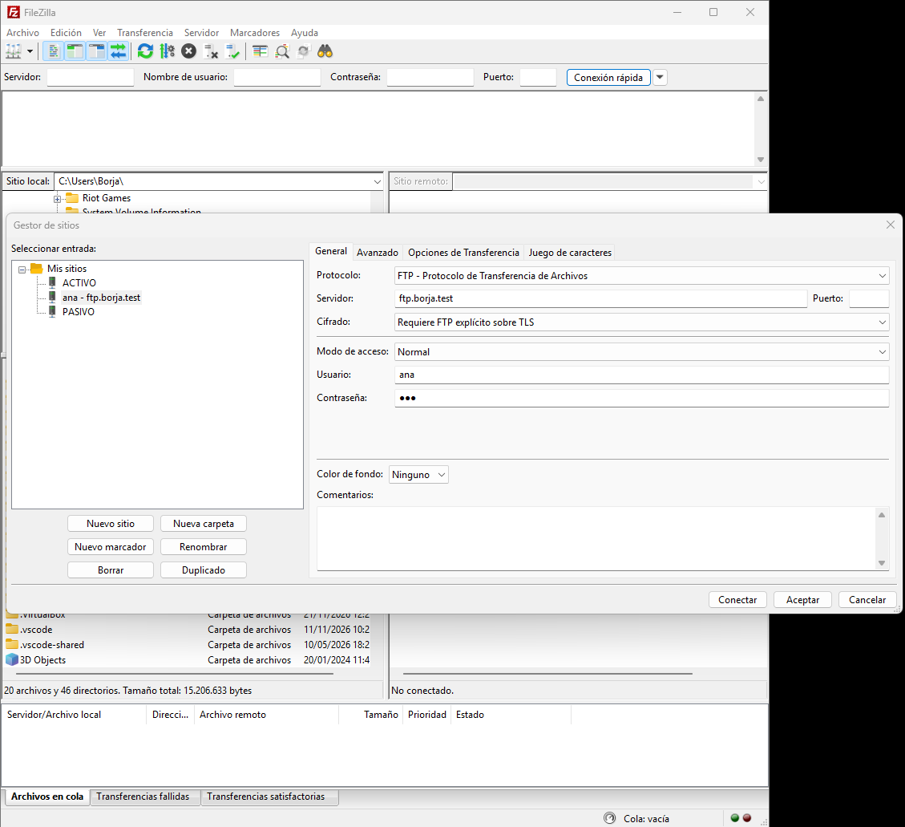

Al conectar sale el aviso del certificado. Sale porque es autofirmado y FileZilla no puede comprobar quién lo ha firmado. Se ven el nombre `borja.test`, los nombres alternativos y las fechas:

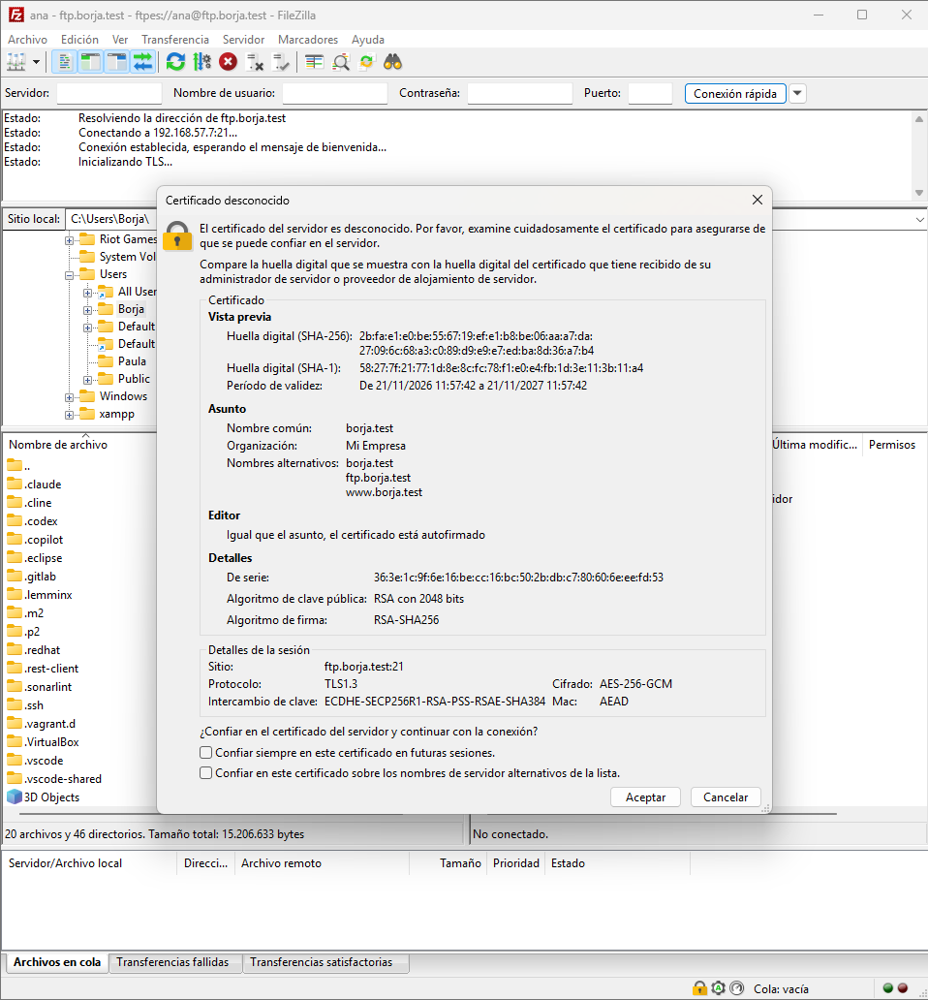

Después de aceptarlo:


Resuelve `ftp.borja.test` a `192.168.57.7` con mi DNS, establece la conexión TLS y `ana` empieza directamente en `/var/www/html`, gracias a su `local_root`. El mensaje `El servidor no permite caracteres no ASCII` quiere decir que vsftpd no admite tildes ni eñes en los nombres de los ficheros.

### 10.2. Subida de una página

Creé un `index.html` nuevo en una carpeta fuera del repositorio. La primera vez se quedó como `index.html.txt` y vacío, porque el Explorador ocultaba la extensión. Lo subí arrastrándolo a `/var/www/html` y sobrescribiendo el que había:

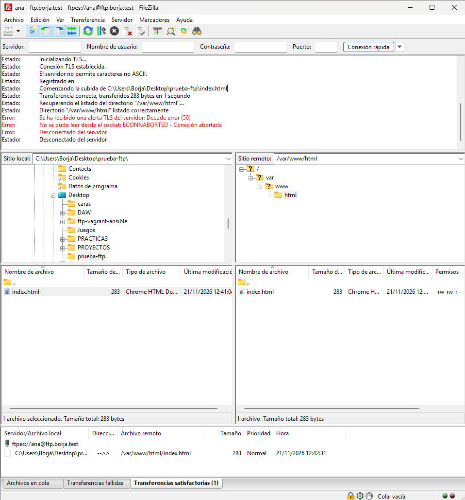

`Transferencia correcta, transferidos 283 bytes`. Justo después sale `Se ha recibido una alerta TLS del servidor: Decode error (50)`: es al cerrar la conexión de la transferencia, cuando el fichero ya ha llegado entero. Es un problema conocido de vsftpd con TLS y FileZilla al cortar la sesión, y no afecta a la subida.

En el navegador, después de recargar con **Ctrl + F5** para que no use la caché:


Apache sirve la página que ha subido `ana`.

### 10.3. `juan` enjaulado

Dupliqué el sitio cambiando el usuario por `juan`:


`juan` ve su carpeta como `/`. En realidad es `/home/juan`, pero como está enjaulado vsftpd le hace creer que es la raíz. Si intenta ir a `/var/www/html`:

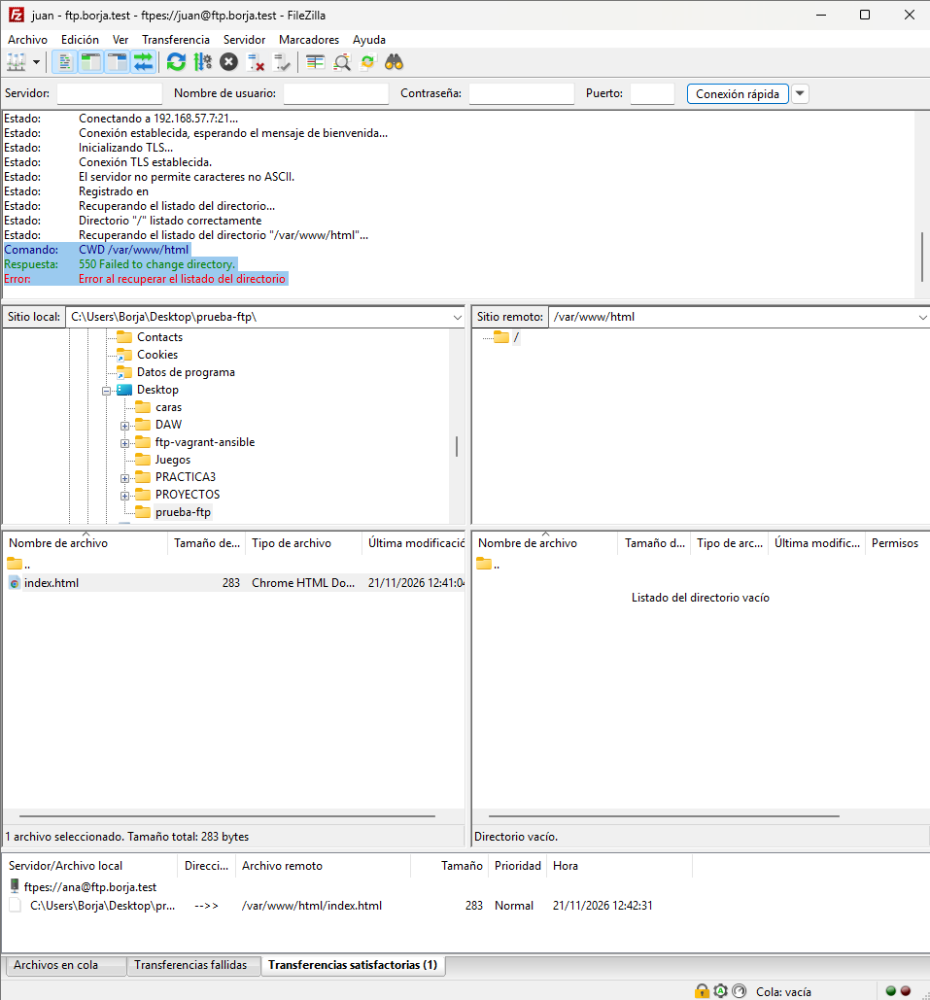

`550 Failed to change directory`: dentro de su jaula esa carpeta no existe.

### 10.4. Accesos rechazados

Con el modo de acceso **Anónimo**:

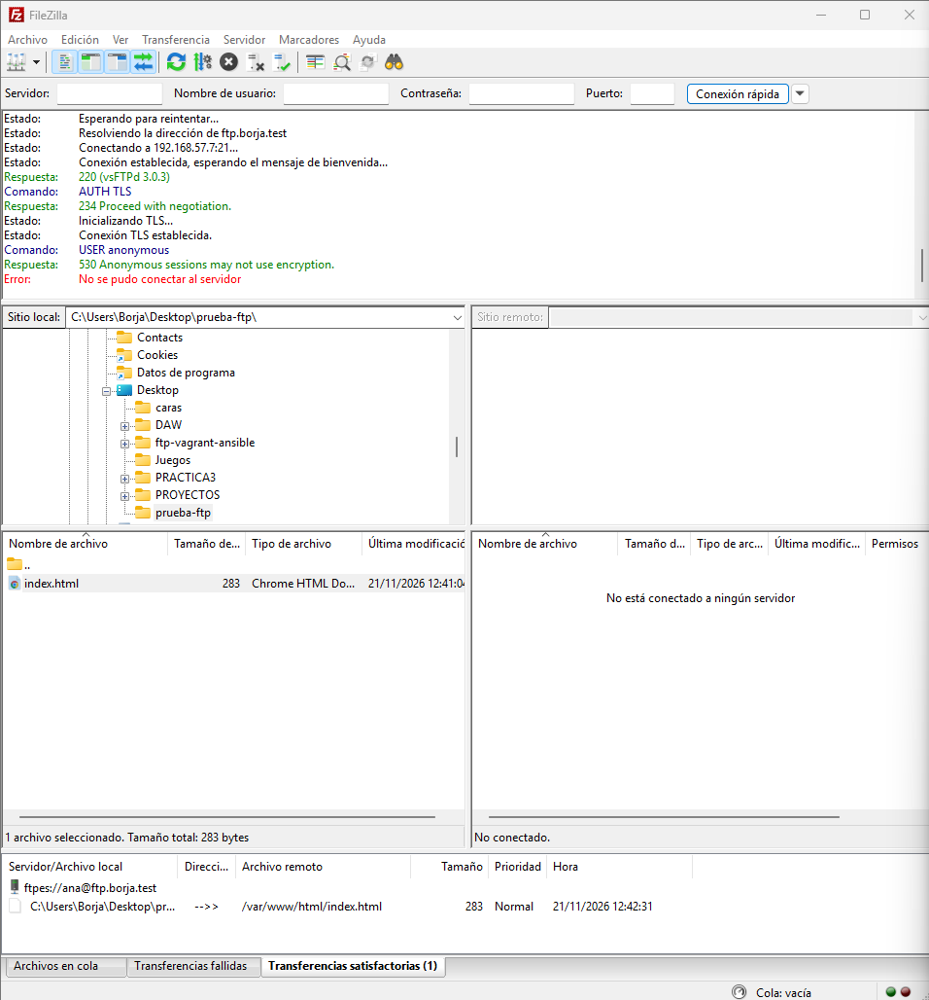

Lo rechaza con `530`, por `anonymous_enable=NO`.

Con un usuario que no existe (`pepe`):

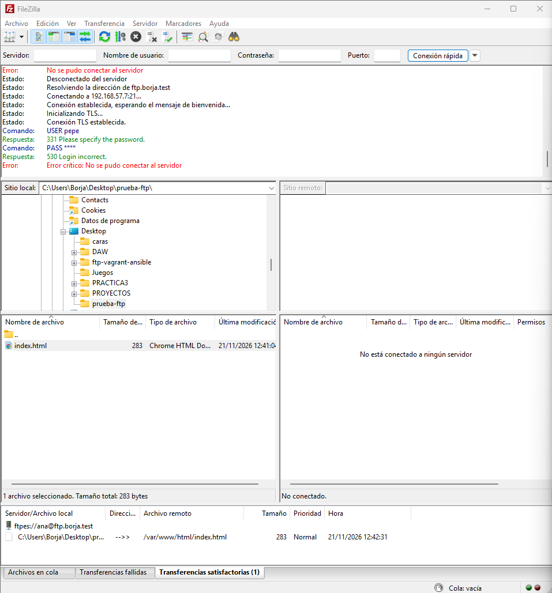

`530 Login incorrect`. Solo entran los usuarios locales con su contraseña.

## 11. Prueba desde cero

El enunciado pide comprobar que, borrando todo y clonando el repositorio, `vagrant up` lo monta todo solo.

Antes actualicé el apartado "Cómo ejecutar el proyecto" del [README principal](../README.md): hay que crear `vault_pass.txt` con la contraseña del vault antes de hacer `vagrant up`, porque ese fichero está en el `.gitignore` y no viene al clonar. En Windows lo creo con `Set-Content`, porque si lo hago con `echo ... >`, PowerShell lo guarda en UTF-16 y Ansible no podría leer la contraseña.

Con `git status` comprobé que todo estaba subido, y borré las máquinas:

```bash
vagrant destroy -f
```

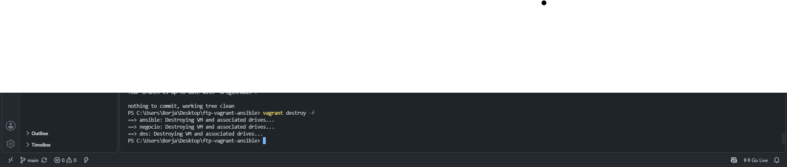

Aparté la carpeta del proyecto (la renombré, para borrarla al final si todo funcionaba) y cloné el repositorio:

```bash
git clone https://github.com/B-V-C/ftp-vagrant-ansible.git
```

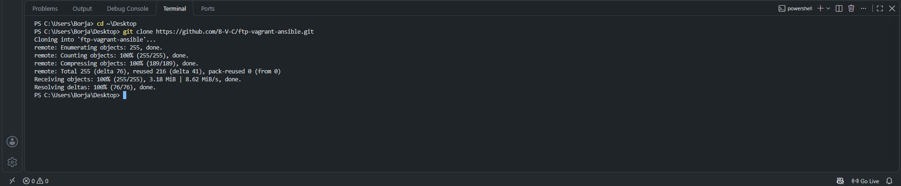

Seguí mi propio README: creé `vault_pass.txt` y lancé `vagrant up`. Creó las tres máquinas, el script instaló Ansible y lanzó los tres playbooks sin que tuviera que hacer nada más:


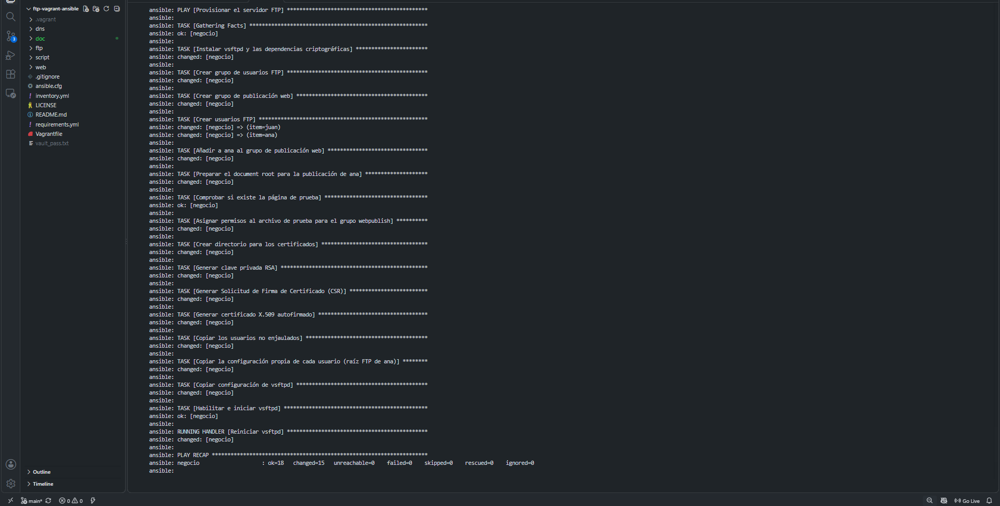

Los tres terminan con `failed=0`. Ahora casi todo sale `changed` porque las máquinas eran nuevas. En la salida también se ve que Vagrant sustituye la clave "insegura" que trae la imagen por una nueva para cada máquina (`Vagrant insecure key detected`), y por eso el script copia las claves después de crear `dns` y `negocio`. También avisa de que las _guest additions_ de la imagen son más antiguas que mi VirtualBox, pero la carpeta compartida `/vagrant` funciona.

Por último pasé las pruebas:

```bash
vagrant ssh dns -c "bash /vagrant/dns/test-dns.sh"
```

```bash
vagrant ssh ansible -c "bash /vagrant/web/test-web.sh"
```


Todas en `[OK]`.

## 12. Conclusiones

En esta práctica he montado tres máquinas con Vagrant y las he configurado con Ansible desde un nodo de control: un DNS con BIND9 para `borja.test`, un servidor web con Apache y un FTP seguro con vsftpd en el que `ana` puede publicar páginas y `juan` queda enjaulado en su carpeta. Todo se monta con un solo `vagrant up`.

Lo que más me ha servido entender:

- **Ansible frente a un script**: los playbooks describen cómo tiene que quedar la máquina y no repiten lo que ya está hecho. Se ve en las provisiones con `changed=0`. También he visto que dos playbooks pueden pelearse por el mismo fichero (los permisos del `index.html`) y que eso rompe esa idea.
- **Ansible Vault**: las contraseñas se suben cifradas y la clave del vault no se sube. Para que `vagrant up` funcione solo, el script la copia de `vault_pass.txt`.
- **vsftpd**: el modo independiente, solo IPv4, sin anónimos, el enjaulado con la lista de excepciones, la configuración por usuario para la carpeta de `ana` y TLS con un certificado autofirmado creado con `community.crypto`.
- **`ansible-lint`**: los tres playbooks pasan con el perfil `production`. En el del FTP cambié el `ignore_errors` por una comprobación con `stat`.

Los problemas que más tiempo me llevaron no fueron de la configuración, sino del entorno: la fecha de las máquinas al restaurarlas desde `saved`, VirtualBox atascado, el DNS de Windows preguntando por la tarjeta equivocada y, sobre todo, la falta de memoria. Con la memoria por defecto, `apt` y las actualizaciones del núcleo se quedaban sin RAM y el sistema mataba los procesos; con 2 GB por máquina se resolvió.

Al terminar dejé la red de mi ordenador como estaba: quité el DNS de la tarjeta de VirtualBox y le devolví la métrica automática, porque con las máquinas apagadas hacía que las webs tardaran en cargar.

Cada cambio está en un commit, y las 40 issues del tablero están cerradas.
