# FTP con Vagrant y Ansible paso a paso

Autor: Borja Valdearenas Cano

## 1. Introducción

En esta práctica monto tres máquinas virtuales con Vagrant (`dns`, `ansible` y `negocio`) y las configuro con Ansible. La máquina `ansible` es el nodo de control: desde ella se lanzan los playbooks que instalan el DNS en `dns` y el servidor web y el FTP seguro en `negocio`.

En este documento voy contando cada paso con sus comprobaciones. El objetivo, las herramientas y cómo arrancar el proyecto están en el [README principal](../README.md).

## 2. GitHub y gestión del proyecto

Creé el repositorio `ftp-vagrant-ansible` en GitHub y añadí al profesor (`frayaIzv`) como colaborador.

Para organizar el trabajo creé un proyecto en GitHub Projects con un tablero de tres columnas: **Por hacer**, **En progreso** y **Hecho**. Las columnas salen en inglés por defecto, así que les cambié el nombre y la descripción. Puse el proyecto público, porque los proyectos tienen permisos aparte del repositorio y así el profesor lo puede ver.

Después creé las issues del enunciado: 7 principales con 33 sub-issues, 40 en total. Cada una tiene el objetivo y la comprobación en la descripción, está asignada a mí y está añadida al tablero.

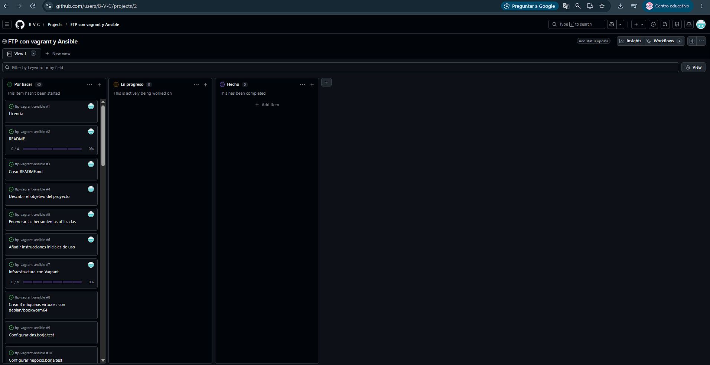

Cuando empiezo una tarea muevo su issue a **En progreso**. Al terminarla, pongo `Closes #N` en el mensaje del commit. GitHub la cierra sola al llegar el commit a `main`, y el tablero la pasa a **Hecho**. Si un commit resuelve varias issues hay que repetir `Closes` delante de cada número (`Closes #3, Closes #4`); si pones `Closes #3, #4` solo se cierra la primera.

## 3. Licencia

Añadí el fichero `LICENSE` desde GitHub con **Add file → Create new file**. Al escribir `LICENSE` como nombre sale el botón **Choose a license template**, que mete el texto completo de la licencia.

Elegí la **GNU GPL v3.0**, que es la misma que usa Ansible. Permite usar y modificar el proyecto, pero obliga a que las versiones modificadas que se distribuyan sigan siendo libres. GitHub la reconoce y la muestra en el apartado **About** del repositorio.

Commit: `Añadida licencia GPLv3 (Closes #1)`. Como lo hice en la web, luego hice `git pull` para tenerlo en mi ordenador.

## 4. README

El `README.md` de la raíz lo hice en tres commits, uno por cada parte, para cerrar cada sub-issue con su commit:

1. Título, autor e introducción (`Closes #3, Closes #4`).
2. Herramientas (`Closes #5`).
3. Cómo ejecutar el proyecto y licencia (`Closes #6, Closes #2`). Con este último cerré también la issue principal.

## 5. Vagrant

### 5.1. Fichero `.gitignore`

Antes de crear las máquinas añadí un `.gitignore` con la carpeta `.vagrant/`. Vagrant la crea al hacer `vagrant up` y dentro guarda las claves privadas de las máquinas, que no se deben subir al repositorio.

```text
# Carpeta de Vagrant con las máquinas y sus claves privadas
.vagrant/
```

Al hacer `git add` me salió este aviso:

```text
warning: in the working copy of '.gitignore', CRLF will be replaced by LF the next time Git touches it
```

No es un error. VS Code guardaba los ficheros con finales de línea de Windows (`CRLF`) y Git los guarda en el repositorio con los de Linux (`LF`). El problema es que Vagrant usa los ficheros de mi carpeta, no los del repositorio, y los ficheros que se copian a las máquinas Debian pueden dar problemas con `CRLF`. Para evitarlo cambié en VS Code la opción **Files: Eol** a `\n`, y así los ficheros nuevos se crean con `LF`.

### 5.2. Script `script/ansible.sh`

Este script prepara la máquina `ansible` como nodo de control. Lo ejecuta Vagrant solo en esa máquina:

- Instala `ansible`, `ansible-lint` y `whois` (este último trae `mkpasswd`, que usaré para las contraseñas del FTP).
- Copia las claves privadas de `dns` y `negocio` desde `/vagrant/.vagrant/...` a `private_keys/` y les pone permisos `600`. Si se usan directamente desde la carpeta compartida con Windows, salen con permisos abiertos y SSH se niega a usarlas.
- Copia los ficheros de Ansible y lanza los playbooks.

Como al principio no existen todos los ficheros, las líneas que los copian están comentadas. Las voy descomentando según los creo. Si no, el script fallaría al intentar copiar algo que no existe, porque empieza con `set -xeu`: `-e` para el script en el primer error, `-u` da error con variables sin definir y `-x` muestra cada comando antes de ejecutarlo.

Commit: `Añadido script/ansible.sh para preparar el nodo de control (Closes #12)`.

### 5.3. Fichero `requirements.yml`

Lista las colecciones de Ansible que necesita el proyecto. Solo hay una, `community.crypto`, que trae los módulos para crear el certificado del FTP:

```yaml
---
collections:
  - name: community.crypto
```

Commit: `Añadido requirements.yml con la colección community.crypto (Closes #13)`.

Después descomenté en `ansible.sh` las dos líneas que lo usan: la que lo copia y la que instala las colecciones con `ansible-galaxy collection install -r requirements.yml`.

### 5.4. Fichero `Vagrantfile`

Define las tres máquinas con la imagen `debian/bookworm64` en la red privada `192.168.57.0/24`:

```ruby
Vagrant.configure("2") do |config|
  config.vm.box = "debian/bookworm64"

  config.vm.define "dns" do |dns|
    dns.vm.hostname = "dns.borja.test"
    dns.vm.network "private_network", ip: "192.168.57.5"
  end

  config.vm.define "negocio" do |negocio|
    negocio.vm.hostname = "negocio.borja.test"
    negocio.vm.network "private_network", ip: "192.168.57.7"
  end

  config.vm.define "ansible" do |ansible|
    ansible.vm.hostname = "ansible.borja.test"
    ansible.vm.network "private_network", ip: "192.168.57.6"
    ansible.vm.provision "shell", path: "script/ansible.sh"
  end
end
```

La máquina `ansible` va la última porque Vagrant crea las máquinas en orden, y su script copia las claves de `dns` y `negocio`. Si se creara antes, esas claves todavía no existirían.

La primera vez que hice `vagrant up` me salió esto:

```text
A Vagrant environment or target machine is required to run this
command. Run `vagrant init` to create a new Vagrant environment.
```

Había escrito mal el nombre del fichero. Tiene que llamarse exactamente `Vagrantfile`, con la `V` mayúscula y sin extensión. Lo renombré y ya funcionó.

### 5.5. Comprobaciones

Con `vagrant up` se crean las tres máquinas. En la salida se ve cómo el script instala Ansible, copia las claves e instala `community.crypto`.

```bash
vagrant status
```

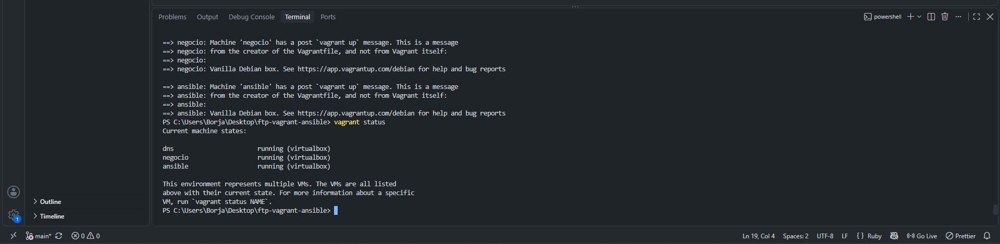

Salen las tres máquinas en `running`. En el enunciado pone que "deben aparecer las dos máquinas", pero son tres.

Para comprobar el nombre y la IP de cada máquina lanzo un comando en cada una sin entrar en ellas:

```bash
vagrant ssh dns -c "hostname -f; ip -4 -br addr show eth1"
```

```bash
vagrant ssh negocio -c "hostname -f; ip -4 -br addr show eth1"
```

```bash
vagrant ssh ansible -c "hostname -f; ip -4 -br addr show eth1"
```

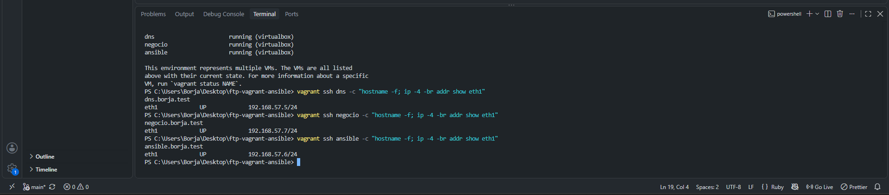

Cada una tiene su nombre completo y su IP en `eth1`, la tarjeta de la red privada: `dns.borja.test` con `192.168.57.5`, `negocio.borja.test` con `192.168.57.7` y `ansible.borja.test` con `192.168.57.6`.

Commit: `Añadido Vagrantfile con las máquinas dns, negocio y ansible (Closes #8, Closes #9, Closes #10, Closes #11, Closes #7)`.

## 6. Ansible

Vagrant crea las máquinas y Ansible configura lo que va dentro. Con un script de Vagrant también se podría instalar todo, pero el script ejecuta los comandos uno detrás de otro y tiene que controlar él solo qué pasa si se ejecuta dos veces. Con Ansible las tareas se escriben en playbooks que dicen cómo tiene que quedar la máquina, y si algo ya está como debe, no lo vuelve a hacer.

### 6.1. Configuración SSH de las máquinas

Para saber con qué usuario y con qué clave entra Vagrant en cada máquina, ejecuto desde mi ordenador:

```bash
vagrant ssh-config
```

En los tres bloques el usuario es `vagrant` (`User vagrant`) y cada máquina tiene su propia clave privada (`IdentityFile`), dentro de `.vagrant/machines/<máquina>/virtualbox/private_key`.

También sale `HostName 127.0.0.1` con un puerto distinto en cada una (2222, 2200 y 2201). Así entra Vagrant desde mi ordenador, por la tarjeta NAT: usa el 2222 para la primera máquina y, como ya está ocupado, a las demás les da otro. Ansible no usa esto, porque está dentro de la red privada y entra directamente por las IPs `192.168.57.5` y `192.168.57.7`.

### 6.2. Fichero `ansible.cfg`

```ini
[defaults]
inventory = inventory.yml
remote_user = vagrant
host_key_checking = False
interpreter_python = auto_silent
```

En el repositorio el fichero tiene además un comentario encima de cada línea explicándola. Qué hace cada cosa:

- `inventory = inventory.yml`: el inventario por defecto, para no tener que poner `-i inventory.yml` en cada comando. En el enunciado se menciona esta línea en el apartado del inventario, pero no aparece en el ejemplo del `ansible.cfg`, así que la añadí.
- `remote_user = vagrant`: el usuario SSH, el mismo que usa Vagrant. Como es igual en todas las máquinas, lo pongo aquí una vez.
- `host_key_checking = False`: Ansible no comprueba la identidad del servidor SSH. La primera vez que te conectas a un servidor, SSH pregunta si confías en él y Ansible se quedaría esperando. Esto no tiene nada que ver con los certificados TLS. Solo vale para la práctica: en producción no te protegería si alguien se hace pasar por el servidor.
- `interpreter_python = auto_silent`: Ansible busca solo el Python de cada máquina sin mostrar avisos.

La clave privada no va en este fichero porque cada máquina tiene la suya; va en el inventario. Es la clave que genera Vagrant, que solo sirve para pruebas y no se sube al repositorio (por eso está `.vagrant/` en el `.gitignore`).

Al crear este fichero me equivoqué y pegué el contenido dentro de `script/ansible.sh`. Al hacer `git add ansible.cfg` me salió `fatal: pathspec 'ansible.cfg' did not match any files`, porque el fichero no existía. Con `git status` vi que `script/ansible.sh` salía como modificado; deshice el cambio y, cuando `git status` volvió a decir `working tree clean`, creé el `ansible.cfg` en su sitio.

Commit: `Añadido ansible.cfg con las opciones comunes documentadas (Closes #15)`.

### 6.3. Fichero `inventory.yml`

```yaml
all:
  hosts:
    dns:
      ansible_host: 192.168.57.5
      ansible_ssh_private_key_file: ./private_keys/dns.key.rsa
    negocio:
      ansible_host: 192.168.57.7
      ansible_ssh_private_key_file: ./private_keys/negocio.key.rsa
```

Igual que el `ansible.cfg`, en el repositorio tiene un comentario en cada máquina.

- `dns` y `negocio` son alias. Son los nombres que usaré en los playbooks (`hosts: dns`).
- `ansible_host` es la IP de cada máquina en la red privada.
- `ansible_ssh_private_key_file` es la clave de cada máquina, en la ruta donde la copia `ansible.sh`.
- La máquina `ansible` no está en el inventario porque es desde donde se lanzan los comandos, no una de las que se configuran.

Commit: `Añadido inventory.yml con las máquinas dns y negocio (Closes #16, Closes #14)`.

### 6.4. Copiar los ficheros a la máquina `ansible`

Descomenté en `script/ansible.sh` las líneas que copian `ansible.cfg` e `inventory.yml` y el `chown` que los pasa al usuario `vagrant`. El script se ejecuta como `root`, así que sin el `chown` los ficheros serían de `root`.

`vagrant up` solo ejecuta el script la primera vez, así que para volver a lanzarlo:

```bash
vagrant provision ansible
```

En la salida se ve la copia de los dos ficheros. También se ve que `apt-get` dice `already the newest version` y `ansible-galaxy` dice `Nothing to do`: no vuelven a instalar lo que ya está.

Entro en la máquina y miro los ficheros:

```bash
vagrant ssh ansible
```

```bash
ls -l
```

```bash
ls -l private_keys
```

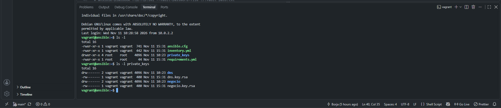

Los ficheros están en `/home/vagrant`. `ansible.cfg` e `inventory.yml` son de `vagrant`, y las claves tienen permisos `-rw-------` (600), que es lo que exige SSH. Los ficheros salen como ejecutables (`-rwxr-xr-x`) porque la carpeta compartida con Windows (`/vagrant`) no guarda los permisos de Linux y `cp` los copia así; no afecta a nada. Las carpetas vacías `dns` y `negocio` las crea el `mkdir` del script, pero no se usan.

Commit: `ansible.sh: copiar ansible.cfg e inventory.yml al nodo de control`.

### 6.5. Comprobaciones

Ansible lee el inventario:

```bash
ansible-inventory --graph
```

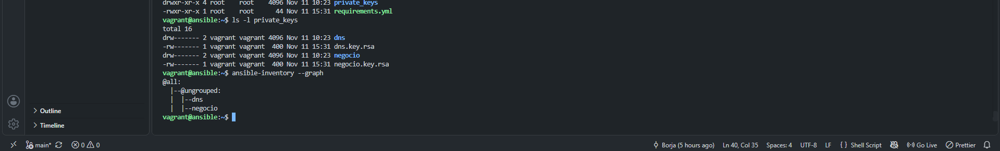

Salen `dns` y `negocio` dentro de `@all`, en `@ungrouped` porque no están en ningún grupo propio. No he puesto `-i inventory.yml` y lo ha encontrado igual, así que también está leyendo el `ansible.cfg`.

Conexión con las dos máquinas:

```bash
ansible all -m ping
```

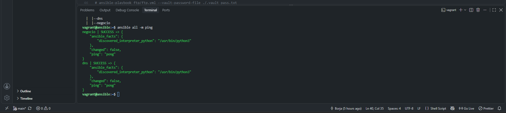

Las dos responden `SUCCESS` con `pong`. Este `ping` no es el del sistema (no envía paquetes ICMP): entra por SSH, comprueba que hay Python y responde. En `discovered_interpreter_python` se ve el Python que ha encontrado, `/usr/bin/python3`. `negocio` sale antes que `dns` porque Ansible se conecta a las dos a la vez y muestra primero la que responde antes.

Comando con privilegios de `root`:

```bash
ansible all -b -a "uptime"
```

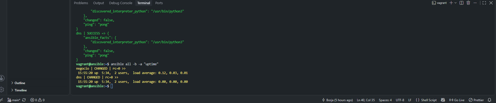

`-a` ejecuta un comando con el módulo `command`, y `-b` (_become_) lo hace con `sudo`. Las dos dan `rc=0`, así que el usuario `vagrant` puede usar `sudo`. Sale `CHANGED` porque con `command` Ansible no sabe si el comando ha cambiado algo, así que siempre lo marca como cambiado.

## 7. Servidor DNS

El DNS es el mismo tipo de servidor que monté en la práctica anterior con BIND9, pero esta vez no lo configuro a mano: escribo los ficheros en el repositorio y un playbook de Ansible los copia y lo deja funcionando.

Todo va en la carpeta `dns/`:

```text
dns/
├── dns.yml
├── test-dns.sh
└── files/
    ├── named.conf.options
    ├── named.conf.local
    ├── db.borja.test
    └── db.192.168.57
```

### 7.1. Ficheros de BIND

Cada fichero lo creé y lo subí con su propio commit.

**`named.conf.options`**:

```text
acl confiables {
    127.0.0.1;
    192.168.57.0/24;
};

options {
    directory "/var/cache/bind";
    allow-transfer { none; };
    listen-on port 53 { 127.0.0.1; 192.168.57.5; };
    listen-on-v6 { none; };
    recursion yes;
    allow-recursion { confiables; };
    dnssec-validation auto;
};
```

Es casi igual que el de la práctica anterior, con la red `57` en vez de la `56`. La recursión solo se permite al propio servidor y a la red privada, como pide el enunciado. Hay dos cambios:

- En la práctica anterior limitaba BIND a IPv4 con `-4` en `/etc/default/named`. Aquí lo hago con `listen-on-v6 { none; }` en las opciones y así no hace falta copiar otro fichero.
- Uso `dnssec-validation auto`, que es el valor que trae Debian: BIND valida DNSSEC con la clave de la raíz que trae incluida.

**`named.conf.local`** declara las dos zonas. Las rutas son las de `/var/lib/bind/`, que es donde el playbook copia las zonas:

```text
zone "borja.test" {
    type master;
    file "/var/lib/bind/db.borja.test";
};

zone "57.168.192.in-addr.arpa" {
    type master;
    file "/var/lib/bind/db.192.168.57";
};
```

**`db.borja.test`**, la zona directa:

```text
$TTL 86400
@   IN SOA dns.borja.test. admin.borja.test. (
        2026111301 ; Serial
        3600       ; Refresh
        1800       ; Retry
        604800     ; Expire
        86400 )    ; Negative Cache TTL
;
@        IN NS     dns.borja.test.
dns      IN A      192.168.57.5
negocio  IN A      192.168.57.7
www      IN CNAME  negocio.borja.test.
ftp      IN CNAME  negocio.borja.test.
```

`www` y `ftp` son alias de `negocio`: así el navegador va a `www.borja.test`, FileZilla a `ftp.borja.test`, y los dos acaban en la misma máquina.

**`db.192.168.57`**, la zona inversa, con un PTR por cada máquina. El número es el último octeto de la IP:

```text
@   IN NS   dns.borja.test.
5   IN PTR  dns.borja.test.
7   IN PTR  negocio.borja.test.
```

`www` y `ftp` no tienen PTR porque son alias: la IP `.7` apunta al nombre real de la máquina, `negocio.borja.test`.

Los dos ficheros de zona terminan con un salto de línea. En la práctica anterior `named-checkzone` me avisaba de `file does not end with newline`, así que esta vez lo puse desde el principio.

### 7.2. Playbook `dns/dns.yml`

Es el del enunciado con `equipo` cambiado por `borja`. Lo único que añadí es el paquete `bind9-dnsutils`, que trae `dig` y `nslookup` para el script de pruebas.

Qué hace:

1. Instala `bind9` y `bind9-dnsutils` con el módulo `apt`.
2. Copia `named.conf.options` y `named.conf.local` a `/etc/bind/`.
3. Copia las dos zonas a `/var/lib/bind/` con dueño `bind`, para que BIND las pueda leer. Lo hace con una sola tarea y un `loop` que recorre los dos ficheros.
4. Comprueba la configuración con `named-checkconf` y cada zona con `named-checkzone`, los mismos comandos que usé a mano en la práctica anterior. Si hay un error, el playbook se para antes de reiniciar BIND.
5. Deja BIND habilitado y arrancado.

Las tareas que copian ficheros tienen `notify: Reiniciar BIND`. Si alguna cambia algo, avisa al _handler_, que reinicia BIND una sola vez al final. Las tareas de comprobación llevan `changed_when: false` porque no cambian nada; sin eso Ansible las marcaría siempre como `changed`, igual que pasó con `uptime`.

Para que se ejecute, descomenté en `script/ansible.sh` la línea que copia la carpeta `dns` y la que lanza `ansible-playbook dns/dns.yml`. La línea `chown -R vagrant:vagrant ./{dns,web,ftp}` la dejé comentada, porque `web` y `ftp` todavía no existen y, con `set -e`, el script se pararía.

### 7.3. Problema: la fecha de las máquinas

Al día siguiente, `vagrant status` me decía que las máquinas estaban en `saved`. Las arranqué con `vagrant up` y lancé `vagrant provision ansible`, pero falló el `apt-get update`:

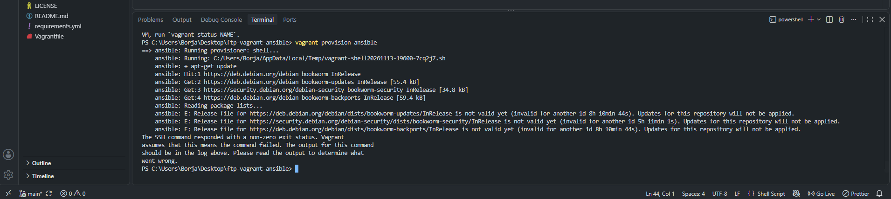

`apt` decía que los ficheros de Debian "todavía no eran válidos" (`is not valid yet`). Miré la fecha de la máquina:

```bash
vagrant ssh ansible -c "date"
```

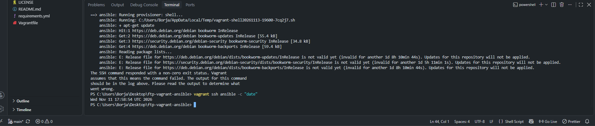

Tenía la fecha del día que dejé de trabajar. El estado `saved` es como suspender el ordenador: VirtualBox guarda la máquina tal cual y el reloj se queda congelado. Al despertarla seguía con esa hora, y para ella los ficheros de Debian venían "del futuro". Como el script tiene `set -e`, en cuanto falló `apt-get update` se paró.

Lo arreglé reiniciando las tres máquinas, que al arrancar cogen la hora del ordenador:

```bash
vagrant reload
```

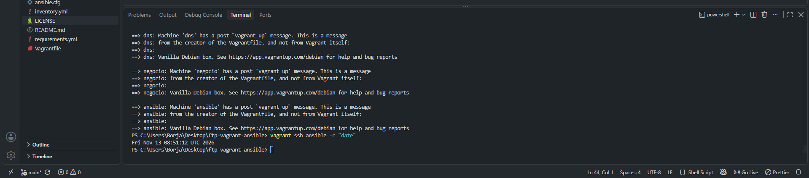

Ahora, antes de apagar el ordenador, apago las máquinas con `vagrant halt` para que no se queden en `saved`.

### 7.4. Ejecución del playbook

```bash
vagrant provision ansible
```

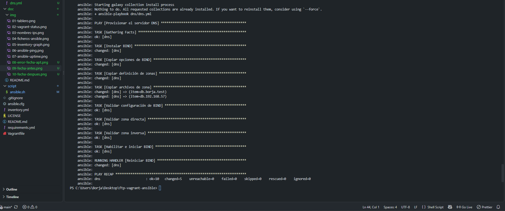

El resumen da `ok=10 changed=5 failed=0`. Las 5 tareas `changed` son la instalación, las tres copias de ficheros y el reinicio. Las comprobaciones salen `ok` gracias al `changed_when: false`. El _handler_ `Reiniciar BIND` se ejecuta una sola vez al final, aunque lo avisaron tres tareas.

Para comprobar que Ansible analiza el playbook sin errores, dentro de la máquina `ansible`:

```bash
ansible-playbook dns/dns.yml --syntax-check
```

```bash
ansible-lint dns/dns.yml
```

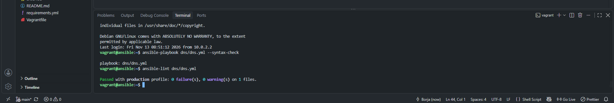

`--syntax-check` solo comprueba que el YAML y la estructura son correctos, sin ejecutar nada. `ansible-lint` revisa además buenas prácticas, y pasa con el perfil `production`, que es el más estricto, con 0 fallos y 0 avisos.

Commits: uno para el playbook y otro para el cambio en `ansible.sh`.

### 7.5. Script de pruebas `dns/test-dns.sh`

El script pregunta a `192.168.57.5` con `dig ... +short` y compara cada respuesta con la que espera:

- Registros A: `dns` y `negocio`.
- CNAME: `www` y `ftp`, que tienen que apuntar a `negocio.borja.test.`.
- PTR: `192.168.57.5` y `192.168.57.7`.

Si coincide escribe `[OK]` y si no `[FALLO]`. Al final termina con código `0` si todo ha ido bien o con el número de fallos. En la práctica anterior el `test.sh` solo mostraba las respuestas y tenía que revisarlas yo; este las comprueba solo.

Lo ejecuto en la máquina `dns`, que es la que tiene `dig`:

```bash
vagrant ssh dns -c "bash /vagrant/dns/test-dns.sh"
```

La primera vez me salió esto:

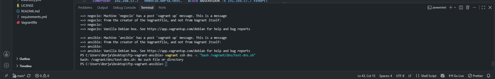

Con `ls dns` vi que había llamado al fichero `test.dns.sh`, con punto en vez de guion. Lo renombré a `test-dns.sh`:

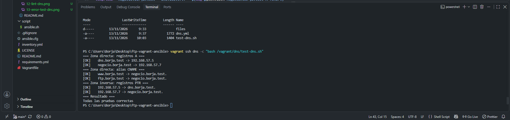

Las 6 pruebas salen `[OK]`.

Commit: `DNS: añadido script de pruebas de los registros directos e inversos (Closes #18, Closes #19, Closes #20, Closes #21, Closes #22, Closes #23, Closes #24, Closes #17)`. Con el script se comprueban todas las sub-issues del DNS, así que las cerré todas con este commit.

### 7.6. DNS en mi ordenador

Para poder usar `www.borja.test` en el navegador y `ftp.borja.test` en FileZilla, puse mi servidor como DNS de Windows. En **Conexiones de red** (`ncpa.cpl`) → adaptador Wi-Fi → **Propiedades** → **TCP/IPv4**:

- DNS preferido: `192.168.57.5`
- DNS alternativo: `8.8.8.8`

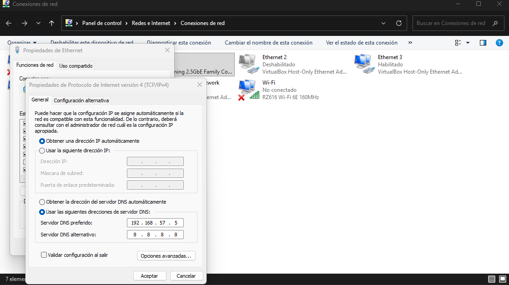

El alternativo lo añadí yo, para no quedarme sin Internet cuando las máquinas están apagadas: si el primero no responde, Windows usa el segundo. Antes lo tenía en automático; cuando termine la práctica lo dejaré como estaba.

Lo compruebo desde Windows sin indicar el servidor, para ver que lo usa solo:

```bash
nslookup www.borja.test
```

```bash
nslookup ftp.borja.test
```

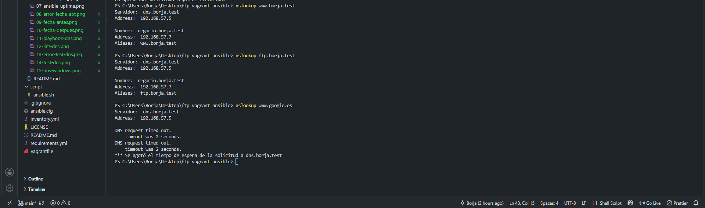

Responde `dns.borja.test` (`192.168.57.5`): sale el nombre del servidor porque `nslookup` lo ha sacado de mi zona inversa. `www` y `ftp` aparecen como alias de `negocio.borja.test` con la IP `192.168.57.7`.

También probé un nombre de Internet:

```bash
nslookup www.google.es
```

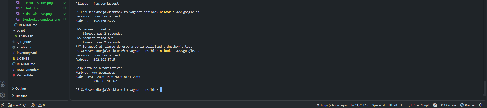

Las dos primeras veces dio `DNS request timed out`. Para un nombre de fuera, mi servidor tiene que ir preguntando desde los servidores raíz y además validar DNSSEC, y la primera vez tardaba más de los 2 segundos que espera `nslookup`. A la tercera ya lo tenía en caché y respondió. Sale `Respuesta no autoritativa` porque mi servidor no es el dueño de `google.es`: lo ha conseguido por recursión. Es lo mismo que la flag `aa` de la práctica anterior.
